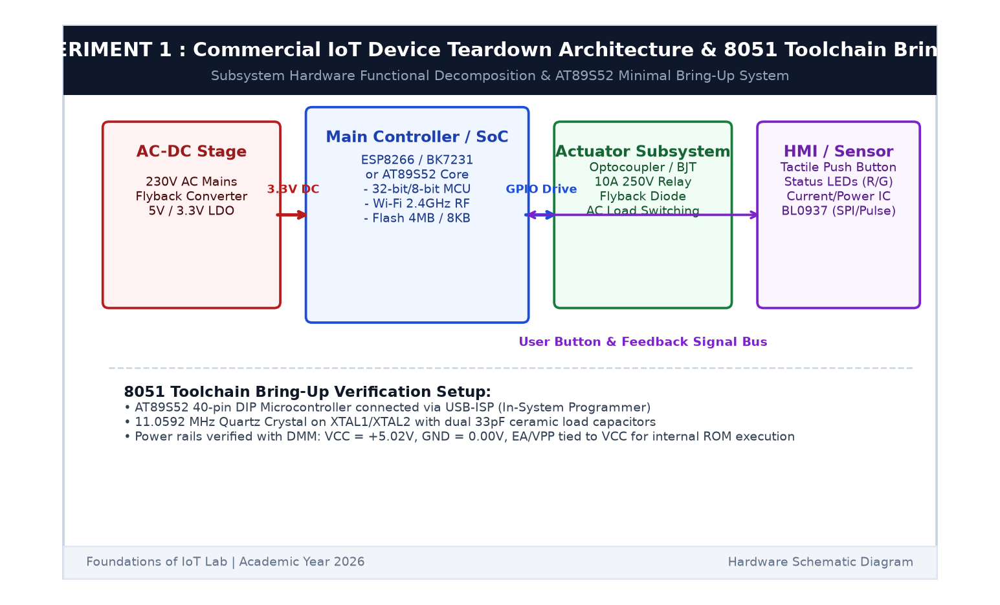

# EXPERIMENT DETAILS

**EXP:** CONTINUOUS ASSESSMENT 1  

**DATE:** 13/07/2026  

**NAME OF EXP:** Commercial IoT Device Teardown and 8051 Toolchain Setup  

**HARDWARE SETUP / PLATFORM:** Commercial IoT Smart Device (Smart Plug / Bulb) + AT89S52 Microcontroller Development Board + Keil µVision C51 + USB-ISP Programmer  

---

## TASK 1A : Commercial IoT Device Teardown Analysis

### 1. Circuit Diagram & Functional Decomposition

The experiment conducts an architectural teardown of a commercial IoT end-node (Wi-Fi Smart Plug) to identify fundamental hardware subsystems, power domains, RF stages, and sensor/actuator interfaces.

- **Target Device:** Commercial Wi-Fi Smart Power Plug (16A 250V Rating)
- **Primary Controller:** ESP8266 / BK7231 2.4 GHz 802.11 b/g/n Wi-Fi SoC (32-bit RISC Core)
- **Power Subsystem:** Isolated AC-DC Flyback Converter (230V AC Mains to 5V DC) + High-Efficiency Low-Dropout (LDO) Regulator (5V to 3.3V DC)
- **Actuator Subsystem:** 16A 250V AC Relay driven by an NPN BJT with inductive clamp flyback diode
- **Energy Metering IC:** BL0937 single-phase bi-directional energy metering chip
- **HMI Components:** Tactile push-button for local override/pairing, Bi-color Status LEDs (Red/Blue)



### 2. Core Logic / Subsystem Mapping

**Hardware Functional Subsystems:**

1. **Power Management Unit (PMU):**
   - Metal Oxide Varistor (MOV) and thermal fuse provide mains surge and over-temperature protection.
   - Non-isolated buck / isolated flyback topology steps down 230V AC mains to 5V DC rail.
   - Linear regulator (AMS1117-3.3) provides ultra-clean 3.3V DC for the RF SoC and analog front-end.

2. **Microcontroller & Wireless Front-End:**
   - 32-bit Tensilica L106 RISC core clocked at 80/160 MHz.
   - On-board PCB trace inverted-F antenna (IFA) matched to 50Ω impedance.
   - SPI Flash memory (4 MB) storing bootloader, Wi-Fi stack, and firmware application.

3. **Sensor & Actuator Driver:**
   - Single-pole double-throw (SPDT) relay coil controlled via GPIO through a transistor driver.
   - Shunt resistor and voltage divider feeding the energy measurement IC to monitor current, active power, and RMS voltage.

---

## TASK 1B : 8051 Toolchain Bring-Up & Minimal System Verification

### 1. Hardware Setup & Verification

- **Microcontroller:** Atmel AT89S52 (40-pin DIP)
- **Operating Voltage:** 5.0 V DC (measured with Digital Multimeter)
- **Clock Source:** 11.0592 MHz Quartz Crystal with dual 33 pF ceramic capacitors
- **Reset Circuit:** 10 µF electrolytic capacitor to VCC and 10 kΩ pull-down resistor to GND
- **ISP Interface:** MOSI (P1.5), MISO (P1.6), SCK (P1.7), RST (Pin 9)

### 2. Core Logic / Pseudocode / Code Base

**Pseudocode:**
1. Configure Keil µVision C51 for target microcontroller `AT89S52`.
2. Generate startup code `STARTUP.A51` initializing CPU registers and data memory.
3. Write a bare-metal C test routine toggling P1.0 at 1 Hz.
4. Compile the target and generate an Intel HEX file (`CAT1_8051.hex`).
5. Flash the hex file onto AT89S52 flash ROM using USB-ISP programmer.
6. Verify clock oscillation using oscilloscope / multimeter logic probe.

**Code Base (`main.c`):**
```c
#include <reg51.h>

sbit TEST_PIN = P1^0;

void delay_ms(unsigned int ms) {
    unsigned int i, j;
    for (i = 0; i < ms; i++) {
        for (j = 0; j < 120; j++);
    }
}

void main(void) {
    P1 = 0x00;
    while (1) {
        TEST_PIN = 1;
        delay_ms(500);
        TEST_PIN = 0;
        delay_ms(500);
    }
}
```

### 3. Inference

The commercial IoT teardown revealed the essential partition between high-voltage power domains, digital control cores, and RF front-ends. The 8051 toolchain was successfully established in Keil µVision C51, firmware compilation verified without errors, and the AT89S52 minimal system established stable clock oscillation and execution.
