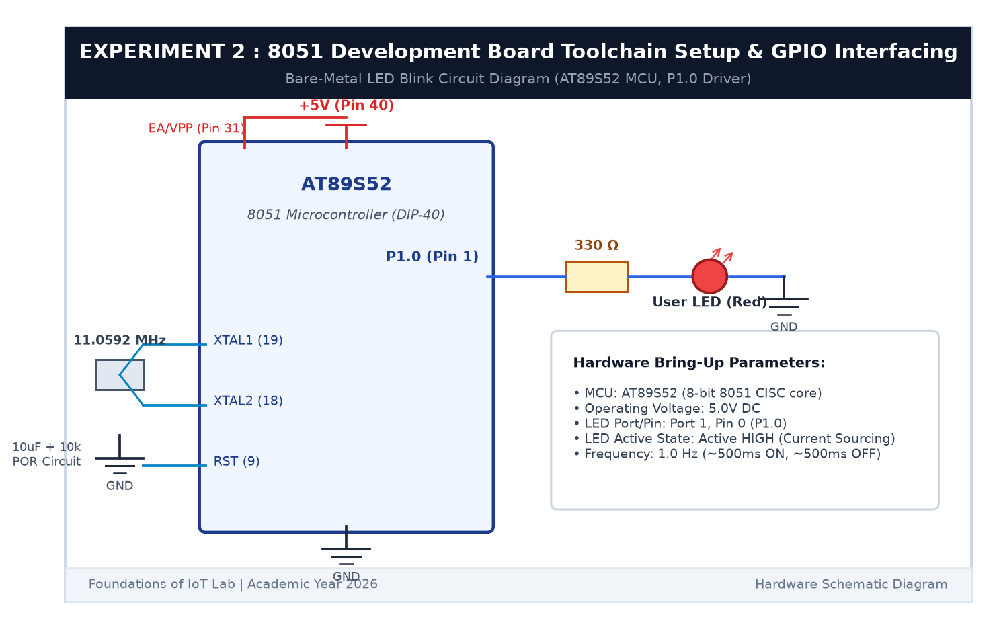

# EXPERIMENT DETAILS

**EXP:** CONTINUOUS ASSESSMENT 2  

**DATE:** 20/07/2026  

**NAME OF EXP:** 8051 Development Board Tool Chain Setup & GPIO Interfacing  

**HARDWARE SETUP / PLATFORM:** 8051 Microcontroller (AT89S52) + Keil µVision C51 + USB-ISP Programmer + Breadboard + Red LED + 330Ω Resistor  

---

## TASK 2A : Hardware Board Bring-Up

### 1. Circuit Diagram

This experiment demonstrates basic GPIO output control using the AT89S52 microcontroller to blink an external LED at ~1 Hz.

- **Microcontroller:** AT89S52 (40-Pin DIP package)
- **Clock:** 11.0592 MHz crystal with two 33pF capacitors
- **Power Supply:** +5V DC regulated
- **LED Connection:** Port 1 Pin 0 (`P1.0`, Pin 1) connected in series with a 330Ω current-limiting resistor to ground



### 2. Hardware Bring-Up Sheet

| Parameter | Student Entry / Value Observed |
|---|---|
| **MCU** | Atmel AT89S52 |
| **CPU Core** | 8051 8-bit CISC |
| **Operating Voltage** | +5.02 V DC (checked with multimeter) |
| **Debug / Programmer Interface** | USB-ISP Header (SPI lines MOSI/MISO/SCK/RST) |
| **LED GPIO Port** | Port 1 |
| **LED GPIO Pin** | P1.0 (Physical Pin 1) |
| **LED Active State** | Active HIGH (1 = LED ON, 0 = LED OFF) |
| **LED Frequency (Hz)** | ~1.0 Hz (500 ms ON, 500 ms OFF) |

---

## TASK 2B : Bare-Metal LED Blink & Delay Function

### 1. Core Logic / Pseudocode / Code Base

**Working Principle:**

The 8051 microcontroller controls its I/O pins through Special Function Registers (SFRs). Port 1 is memory-mapped at address `0x90`. By defining `sbit LED = P1^0`, we can directly write `1` (5V) to turn the LED on, or `0` (0V) to turn it off.

To create the blinking effect, we built a modular software delay function `delay_ms()` using nested loops. At 11.0592 MHz, one machine cycle takes approximately 1.085 µs. A calibrated loop of 120 iterations produces about 1 millisecond of delay.

**Pseudocode:**
1. Include register definitions from `reg51.h`.
2. Map `P1.0` to the identifier `LED`.
3. Create `delay_ms(ms)` using two nested for-loops.
4. In `main()`, initialize Port 1 to `0x00`.
5. In an infinite loop:
   - Turn the LED ON by writing `LED = 1`.
   - Call `delay_ms(500)`.
   - Turn the LED OFF by writing `LED = 0`.
   - Call `delay_ms(500)`.

**Code Base (`main.c`):**
```c
#include <reg51.h>

sbit LED = P1^0;

void delay_ms(unsigned int ms) {
    unsigned int i, j;
    for (i = 0; i < ms; i++) {
        for (j = 0; j < 120; j++);
    }
}

void main(void) {
    P1 = 0x00;
    while (1) {
        LED = 1;
        delay_ms(500);
        LED = 0;
        delay_ms(500);
    }
}
```

### 3. Inference

The hardware voltage rails were verified at 5.02V, confirming stable board power. Writing to the `P1.0` bit latch successfully alternated the pin between 5V and 0V, causing the LED to blink smoothly at 1 Hz. We learned how to access 8051 memory-mapped GPIO registers and calibrate software delay loops in Keil C51.
