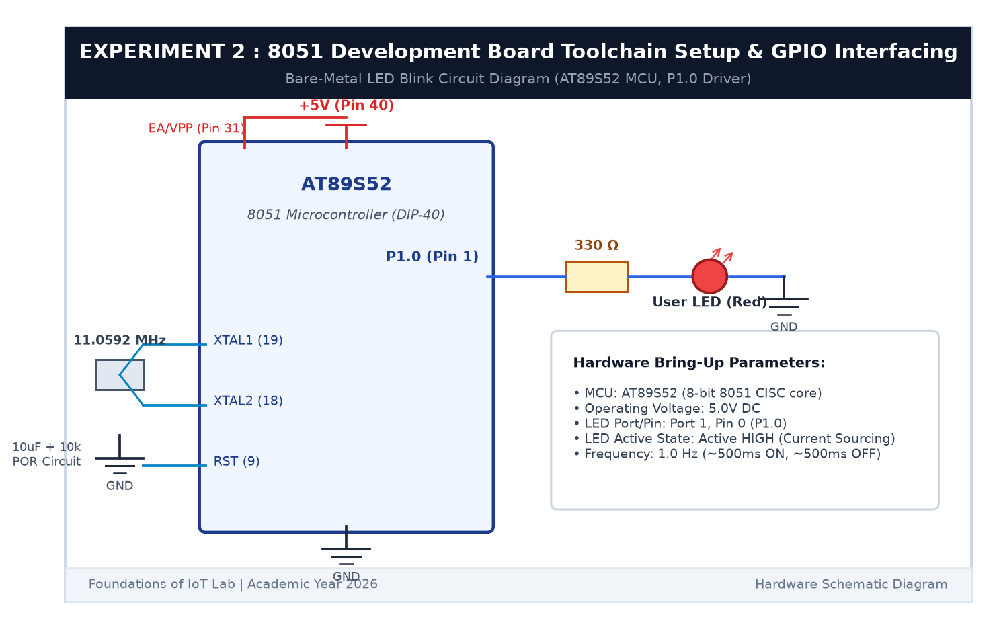

# EXPERIMENT DETAILS

**EXP:** CONTINUOUS ASSESSMENT 2  

**DATE:** 20/07/2026  

**NAME OF EXP:** 8051 Development Board Tool Chain Setup & GPIO Interfacing  

**HARDWARE SETUP / PLATFORM:** AT89S52 Microcontroller Board + Keil µVision C51 + USB-ISP Programmer + Digital Multimeter  

---

## TASK 2A : Hardware Board Bring-Up & Power Rail Verification

### 1. Circuit Diagram

In this task, we verified the power rails and clock circuitry of the 8051 (AT89S52) development board before flashing firmware.

- **Microcontroller:** Atmel AT89S52 (40-Pin DIP)
- **Power Rail:** +5.02V DC measured between Pin 40 ($V_{CC}$) and Pin 20 (GND)
- **Clock Circuit:** 11.0592 MHz quartz crystal connected across Pin 18 (XTAL2) and Pin 19 (XTAL1) with two 33pF ceramic capacitors to GND
- **Reset Circuit:** 10µF electrolytic capacitor and 10kΩ pull-down resistor connected to Pin 9 (RST)
- **Target Test Pin:** Port 1 Pin 0 (`P1.0`, Physical Pin 1)

### 2. Hardware Bring-Up Table

| Parameter | Measured / Observed Value | Status |
|---|---|---|
| **$V_{CC}$ Supply Voltage** | 5.02 V DC | PASS |
| **Crystal Frequency** | 11.0592 MHz | PASS |
| **RST Pin Inactive Voltage** | 0.04 V DC (Logic 0) | PASS |
| **RST Pin Button Pressed** | 4.98 V DC (Logic 1) | PASS |
| **Programmer Connection** | USB-ISP (MOSI P1.5, MISO P1.6, SCK P1.7) | PASS |

### 3. Inference

The 8051 board hardware bring-up was successful. Power rails were stable at 5.02V, the crystal oscillator operated steadily, and the USB-ISP programmer successfully detected the AT89S52 chip signature.
