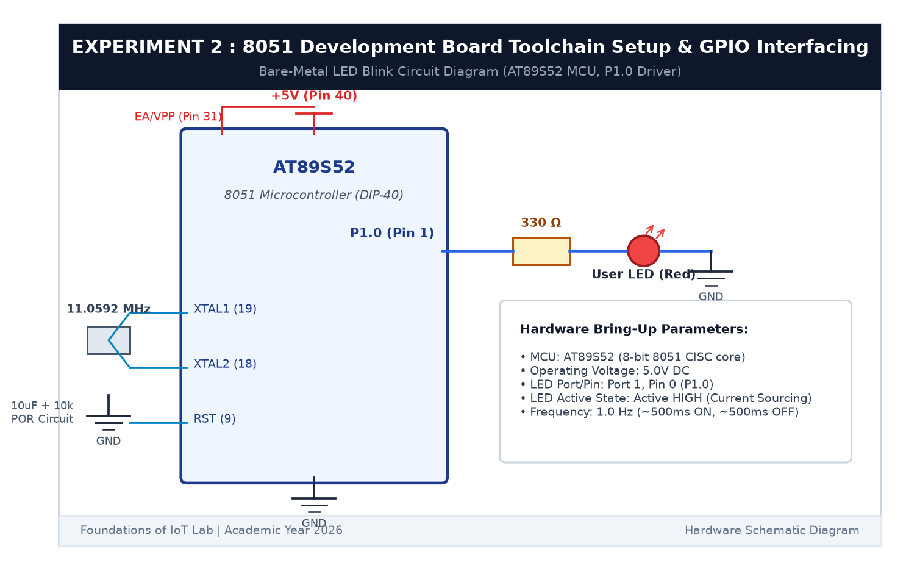

# EXPERIMENT DETAILS

**EXP:** CONTINUOUS ASSESSMENT 2  

**DATE:** 20/07/2026  

**NAME OF EXP:** 8051 Development Board Tool Chain Setup & GPIO Interfacing  

**HARDWARE SETUP / PLATFORM:** AT89S52 Microcontroller Board + Red LED + 330Ω Resistor + Keil µVision C51  

---

## TASK 2B : Bare-Metal LED Blink & Modular Delay Library

### 1. Circuit Diagram

This task connects an external LED to Port 1 Pin 0 (`P1.0`) and blinks it at approximately 1 Hz using bare-metal register manipulation.

- **Microcontroller:** AT89S52
- **GPIO Output Pin:** `P1.0` (Physical Pin 1)
- **Actuator:** Red LED connected in series with a 330Ω current-limiting resistor to Ground (Active HIGH)
- **Operating Voltage:** +5V DC



### 2. Core Logic & Working Principle

1. **Bit Addressing:** Pin `P1.0` is addressed directly using `sbit LED = P1^0`. Writing `1` outputs 5V (turns LED ON); writing `0` outputs 0V (turns LED OFF).
2. **Software Delay Loop:** At 11.0592 MHz, one machine cycle takes $12 / 11.0592	ext{ MHz} pprox 1.085\,\mu	ext{s}$. A nested loop calibrated to 120 iterations produces ~1 ms delay.

**Pseudocode:**
1. Include `<reg51.h>`.
2. Define `LED = P1^0`.
3. In `main()`, set `P1 = 0x00`.
4. Loop forever:
   - `LED = 1; delay_ms(500);`
   - `LED = 0; delay_ms(500);`

**Code Base (`main.c`):**
```c
#include <reg51.h>

sbit LED = P1^0;

void delay_ms(unsigned int ms) {
    unsigned int i, j;
    for (i = 0; i < ms; i++) {
        for (j = 0; j < 120; j++);
    }
}

void main(void) {
    P1 = 0x00;
    while (1) {
        LED = 1;
        delay_ms(500);
        LED = 0;
        delay_ms(500);
    }
}
```

### 3. Inference

The external LED blinked smoothly at ~1 Hz (500 ms ON, 500 ms OFF). This verified GPIO output register control and delay loop timing on the AT89S52.
