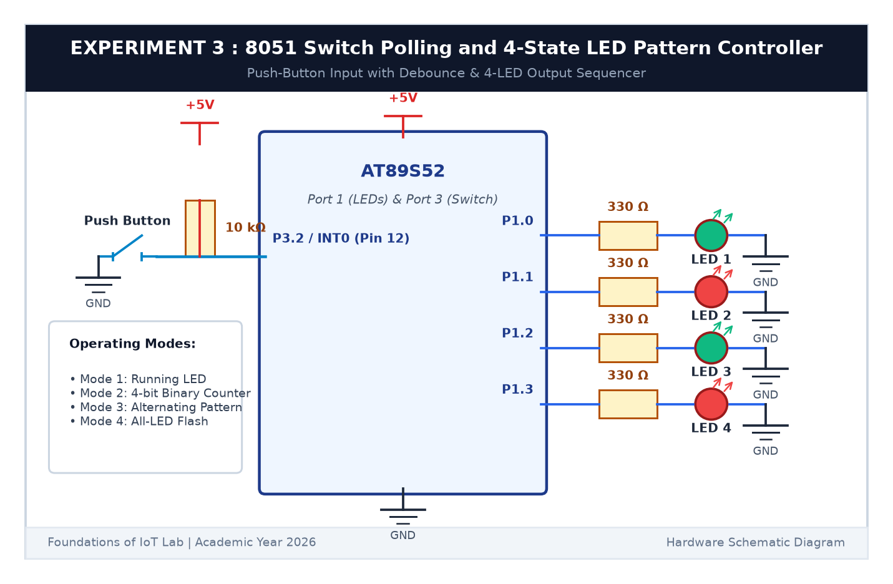

# EXPERIMENT DETAILS

**EXP:** CONTINUOUS ASSESSMENT 3  

**DATE:** 27/07/2026  

**NAME OF EXP:** Timer-Based LED Pattern Generator and Button Interrupt Controller / Switch Polling  

**HARDWARE SETUP / PLATFORM:** AT89S52 Microcontroller Board + 4 LEDs + 1 Push Button + 10kΩ Resistor + Keil µVision C51  

---

## TASK 3A : Switch Polling with Software Debouncing

### 1. Circuit Diagram

The circuit connects 4 LEDs to Port 1 (`P1.0` through `P1.3`) and a push button to Port 3 Pin 2 (`P3.2`).

- **Microcontroller:** AT89S52
- **Switch Input Pin:** `P3.2` with an external 10kΩ pull-up resistor to +5V (Active LOW)
- **LED Output Pins:** `P1.0` (LED1), `P1.1` (LED2), `P1.2` (LED3), `P1.3` (LED4)
- **Resistors:** 330Ω in series with each LED to limit current



### 2. Core Logic & Switch Debouncing

Mechanical buttons physically bounce when pressed, which can make the microcontroller think the button was pressed 5 to 10 times in a fraction of a second. To fix this, we use software debouncing:
1. When we detect `P3.2 == 0` (button pressed), we wait 25 ms for the contacts to settle.
2. If `P3.2` is still `0`, we accept it as a genuine button press and change the mode.
3. We then wait for the user to release the button (`while (BUTTON == 0)`) with another small delay to prevent multiple triggers from a single press.

---

## TASK 3B : 4-State LED Pattern Sequencer

### 1. Operating Modes

Each valid button press increments the mode counter (from 1 to 4, then wraps back to 1):

| Mode Number | Mode Name | Behavior of LEDs |
|:---:|---|---|
| **Mode 1** | **Running LED** | Lights one LED at a time: LED1 $	o$ LED2 $	o$ LED3 $	o$ LED4 $	o$ repeat |
| **Mode 2** | **4-Bit Binary Counter** | Counts from `0000` (0) to `1111` (15) in binary |
| **Mode 3** | **Alternating Pattern** | Toggles odd and even LEDs: `1010` $\leftrightarrow$ `0101` |
| **Mode 4** | **All-LED Flash** | All 4 LEDs flash together: `1111` $\leftrightarrow$ `0000` |

### 2. Code Base (`main.c` excerpt)

```c
#include <reg51.h>

sbit BUTTON = P3^2;

void delay_ms(unsigned int ms) {
    unsigned int i, j;
    for (i = 0; i < ms; i++) {
        for (j = 0; j < 120; j++);
    }
}

unsigned char current_mode = 0;
unsigned char counter_val = 0;

void main(void) {
    BUTTON = 1; /* Set P3.2 as input */
    P1 = 0x00;  /* Turn off all LEDs initially */

    while (1) {
        if (BUTTON == 0) {
            delay_ms(25); /* Debounce delay */
            if (BUTTON == 0) {
                current_mode++;
                if (current_mode > 4) current_mode = 1;
                counter_val = 0;
                while (BUTTON == 0); /* Wait for release */
                delay_ms(25);
            }
        }

        switch (current_mode) {
            case 1: /* Running LED */
                P1 = 0x01; delay_ms(200);
                P1 = 0x02; delay_ms(200);
                P1 = 0x04; delay_ms(200);
                P1 = 0x08; delay_ms(200);
                break;
            case 2: /* Binary Counter */
                P1 = counter_val & 0x0F;
                delay_ms(300);
                counter_val = (counter_val + 1) % 16;
                break;
            case 3: /* Alternating */
                P1 = 0x0A; delay_ms(250);
                P1 = 0x05; delay_ms(250);
                break;
            case 4: /* All Flash */
                P1 = 0x0F; delay_ms(250);
                P1 = 0x00; delay_ms(250);
                break;
        }
    }
}
```

### 3. Inference

Adding software debouncing completely eliminated the erratic skipping behavior caused by mechanical contact bounce. Every single button press moved smoothly to the next LED sequence without false triggers.
