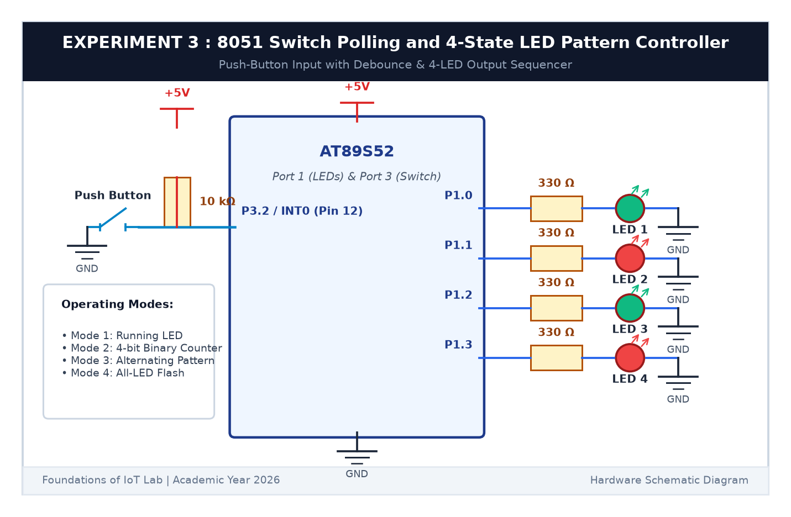

# EXPERIMENT DETAILS

**EXP:** CONTINUOUS ASSESSMENT 3  

**DATE:** 27/07/2026  

**NAME OF EXP:** Timer-Based LED Pattern Generator and Button Interrupt Controller / Switch Polling  

**HARDWARE SETUP / PLATFORM:** AT89S52 Microcontroller Board + Tactile Push Button + 10kΩ Pull-Up Resistor + Keil µVision C51  

---

## TASK 3A : Switch Polling with Software Debouncing

### 1. Circuit Diagram

In this task, we interface an external push button to Port 3 Pin 2 (`P3.2`) with a pull-up resistor and implement switch polling with contact debouncing.

- **Microcontroller:** AT89S52
- **Input Switch Pin:** `P3.2` (Physical Pin 12)
- **Circuit Configuration:** Tactile button connected between `P3.2` and GND; external 10kΩ pull-up resistor to +5V (Active LOW)

### 2. Core Logic & Debouncing Technique

Mechanical push buttons bounce mechanically for 5 to 20 ms upon contact closure, generating spurious pulses that cause false triggers.
1. When `P3.2 == 0` is first detected, the MCU waits 25 ms.
2. The pin is re-read. If still `0`, the press is confirmed as valid.
3. The MCU then waits in a loop `while (BUTTON == 0);` until the user releases the button, followed by another 25 ms delay.

### 3. Inference

Software debouncing completely suppressed mechanical switch chatter, ensuring exactly one registered state transition per physical button press.
