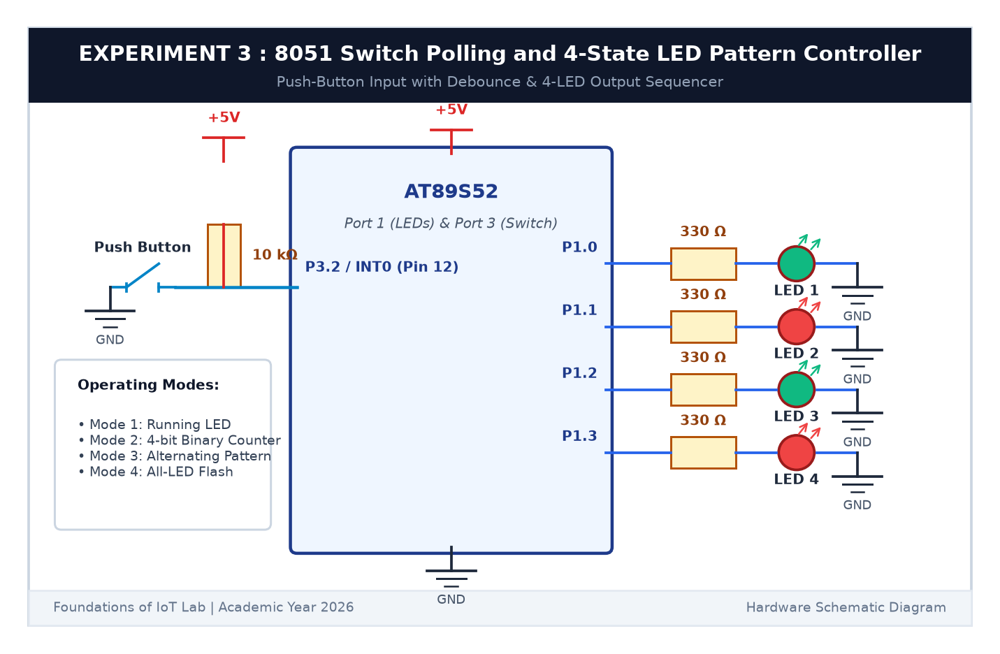

# EXPERIMENT DETAILS

**EXP:** CONTINUOUS ASSESSMENT 3  

**DATE:** 27/07/2026  

**NAME OF EXP:** Timer-Based LED Pattern Generator and Button Interrupt Controller / Switch Polling  

**HARDWARE SETUP / PLATFORM:** AT89S52 Microcontroller Board + 4 LEDs (P1.0-P1.3) + 330Ω Resistors + Push Button (P3.2) + Keil µVision C51  

---

## TASK 3B : 4-State LED Pattern Sequencer

### 1. Circuit Diagram

This task implements a 4-state sequential LED pattern controller where each press of the button advances the mode counter.

- **Microcontroller:** AT89S52
- **LED Pins:** `P1.0` (LED1), `P1.1` (LED2), `P1.2` (LED3), `P1.3` (LED4)
- **Button Pin:** `P3.2` (Active LOW with pull-up)

### 2. 4 Operating Modes

| Mode | Pattern Name | LED Behavior |
|:---:|---|---|
| **1** | **Running LED** | Shifts a single lit LED: $0001_2 	o 0010_2 	o 0100_2 	o 1000_2$ |
| **2** | **4-Bit Binary Counter** | Counts from $0000_2$ (0) to $1111_2$ (15) |
| **3** | **Alternating Pattern** | Flips odd and even LEDs: $1010_2 \leftrightarrow 0101_2$ |
| **4** | **All-LED Flasher** | Flashes all 4 LEDs together: $1111_2 \leftrightarrow 0000_2$ |

### 3. Inference

The state machine transitioned smoothly between all four operating modes on each button press. The LEDs displayed each sequence cleanly.
