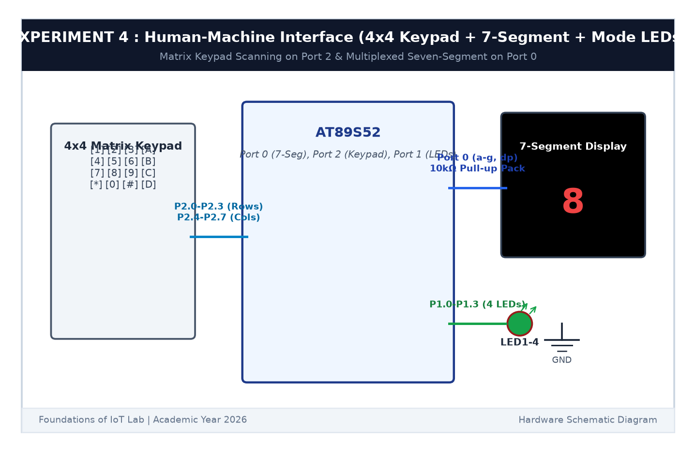

# EXPERIMENT DETAILS

**EXP:** CONTINUOUS ASSESSMENT 4  

**DATE:** 03/08/2026  

**NAME OF EXP:** Human-Machine Interface using Matrix Keypad, LEDs, and Seven-Segment Display  

**HARDWARE SETUP / PLATFORM:** AT89S52 MCU Development Board + 4x4 Matrix Keypad (Port 2) + Common Cathode 7-Segment Display with 10kΩ Resistor Pack (Port 0) + 4x Status LEDs (Port 1) + Keil µVision C51  

---

## TASK 4 : Matrix Keypad Scanning, 7-Segment Feedback & LED Actuation

### 1. Circuit Diagram

The circuit interfaces an input 4x4 matrix keypad, visual numeric feedback via a 7-segment display, and operational mode indication through 4 LEDs.

- **Microcontroller:** AT89S52
- **Keypad Interface:** Port 2 (Rows `P2.0`-`P2.3` Output, Columns `P2.4`-`P2.7` Input with internal pull-ups)
- **7-Segment Display:** Port 0 (`P0.0`-`P0.7` driving segments a-g, dp through external 10 kΩ pull-up network)
- **LED Mode Indicators:** Port 1 (`P1.0`-`P1.3` driving LEDs 1-4 with 330Ω resistors)

### 2. Functional Requirements & Key Mapping

| Key Press | 7-Segment Display | LED Operation / Function Triggered |
|:---:|:---:|---|
| **1** | `1` | LED1 ON (P1.0 = 1, others 0) |
| **2** | `2` | LED2 ON (P1.1 = 1, others 0) |
| **3** | `3` | LED3 ON (P1.2 = 1, others 0) |
| **4** | `4` | LED4 ON (P1.3 = 1, others 0) |
| **5** | `5` | Running LED Pattern ($0001_2 	o 0010_2 	o 0100_2 	o 1000_2$) |
| **6** | `6` | Alternate LEDs Flashing ($1010_2 \leftrightarrow 0101_2$) |
| **7** | `7` | 4-bit Binary Counter (0 to 15 continuous count) |
| **8** | `8` | All LEDs Synchronous Blink ($1111_2 \leftrightarrow 0000_2$) |
| **9** | `9` | All LEDs OFF ($0000_2$) |
| **0** | `0` | System Reset (Clear display and reset controller state) |

### 3. Core Logic / Pseudocode / Code Base

**Working Principle:**

The 4x4 matrix keypad uses row-column scanning. Rows (`P2.0`-`P2.3`) are driven LOW sequentially while columns (`P2.4`-`P2.7`) are read. A pressed switch pulls the corresponding column LOW. Software resolves the (row, column) intersection into numeric key values 0-9.

Upon detecting a valid key press, the segment decoding function outputs the corresponding 7-segment bit pattern onto Port 0, and the central command dispatcher executes the dedicated LED function.

**Pseudocode:**
1. Define 7-segment lookup table for common-cathode encoding.
2. Implement `keypad_scan()`: Drive row $i$ LOW; test columns for logic LOW; return key value.
3. Update 7-segment display on Port 0 with `display_digit(key)`.
4. Dispatch mapped LED function via `switch(key)` (modes 0-9).

**Code Base:**
Implemented cleanly in `main.c` adhering to modular functions: `keypad_scan()`, `display_digit()`, `running_led()`, `alternate_led()`, and `blink_all()`.

### 4. Inference

The HMI subsystem performed matrix keypad scanning without ghosting or false triggers. The 7-segment display correctly reflected the selected input digit while the respective LED pattern executed stably in real time.
