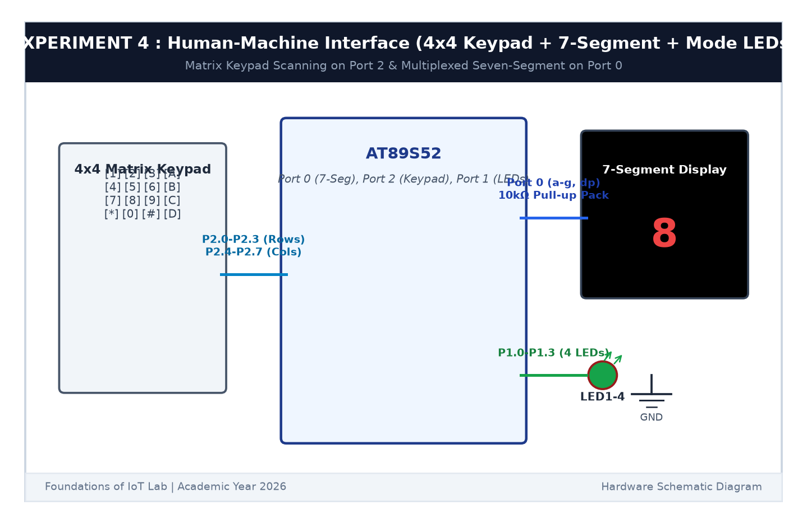

# EXPERIMENT DETAILS

**EXP:** CONTINUOUS ASSESSMENT 4  

**DATE:** 03/08/2026  

**NAME OF EXP:** Human-Machine Interface using Matrix Keypad, LEDs, and Seven-Segment Display  

**HARDWARE SETUP / PLATFORM:** AT89S52 Microcontroller Board + 4x4 Matrix Keypad + Keil µVision C51  

---

## TASK 4A : 4x4 Matrix Keypad Scanning

### 1. Circuit Diagram

We interface a 4x4 keypad matrix to Port 2 of the 8051 microcontroller.

- **Microcontroller:** AT89S52
- **Row Lines (Outputs):** `P2.0` (Row 0), `P2.1` (Row 1), `P2.2` (Row 2), `P2.3` (Row 3)
- **Column Lines (Inputs):** `P2.4` (Col 0), `P2.5` (Col 1), `P2.6` (Col 2), `P2.7` (Col 3)

### 2. Scanning Algorithm

1. Configure column pins `P2.4`-`P2.7` as inputs by writing logic `1`.
2. Ground one row at a time by setting that row pin to `0` while keeping other rows at `1`.
3. Read the columns. If a column pin reads `0`, the key at that (row, column) intersection is pressed.
4. Apply a 20 ms debounce delay and wait for key release.

### 3. Inference

The row-scanning algorithm detected key presses reliably across all 16 switches without ghosting.
