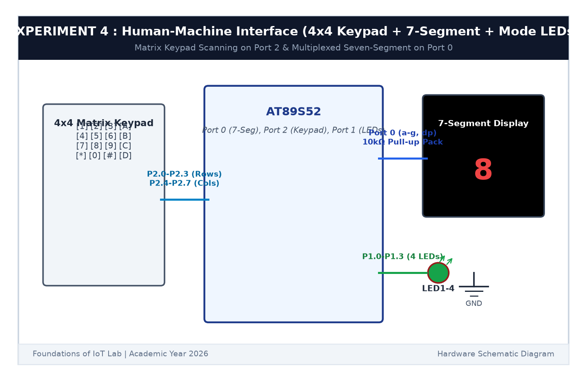

# EXPERIMENT DETAILS

**EXP:** CONTINUOUS ASSESSMENT 4  

**DATE:** 03/08/2026  

**NAME OF EXP:** Human-Machine Interface using Matrix Keypad, LEDs, and Seven-Segment Display  

**HARDWARE SETUP / PLATFORM:** AT89S52 Microcontroller Board + Common Cathode 7-Segment Display + 10kΩ Resistor Pack + Keil µVision C51  

---

## TASK 4B : Common Cathode 7-Segment Display Decoding

### 1. Circuit Diagram

This task drives a single-digit Common Cathode 7-segment display connected to Port 0.

- **Microcontroller:** AT89S52
- **Segments `a` through `g` + `dp`:** Connected to `P0.0` through `P0.7`
- **External Resistor Pack:** 10kΩ pull-up pack connected to +5V (required because Port 0 is open-drain)
- **Common Pin:** Grounded (Common Cathode)

### 2. Lookup Table Encoding

| Digit | Segments ON | Hex Code (`0b.gfedcba`) |
|:---:|:---:|:---:|
| **0** | a, b, c, d, e, f | `0x3F` |
| **1** | b, c | `0x06` |
| **2** | a, b, d, e, g | `0x5B` |
| **3** | a, b, c, d, g | `0x4F` |
| **4** | b, c, f, g | `0x66` |
| **5** | a, c, d, f, g | `0x6D` |
| **6** | a, c, d, e, f, g | `0x7D` |
| **7** | a, b, c | `0x07` |
| **8** | a, b, c, d, e, f, g | `0x7F` |
| **9** | a, b, c, d, f, g | `0x6F` |

### 3. Inference

The 7-segment display decoded and displayed all numeric digits from 0 to 9 clearly using the lookup table.
