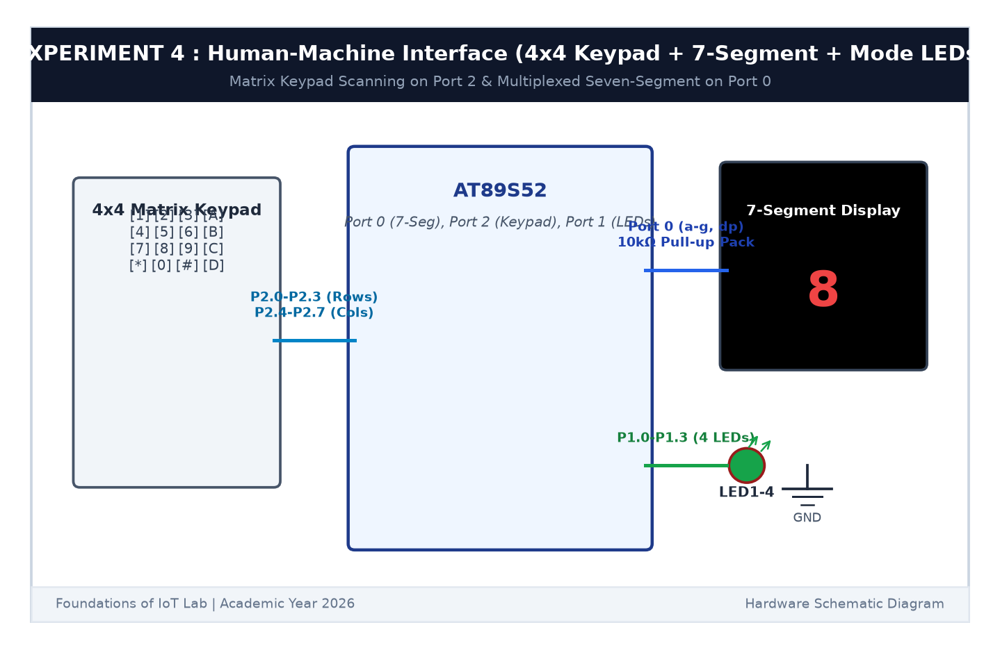

# EXPERIMENT DETAILS

**EXP:** CONTINUOUS ASSESSMENT 4  

**DATE:** 03/08/2026  

**NAME OF EXP:** Human-Machine Interface using Matrix Keypad, LEDs, and Seven-Segment Display  

**HARDWARE SETUP / PLATFORM:** AT89S52 Microcontroller Board + 4x4 Keypad + 7-Segment Display + 4 Mode LEDs + Keil µVision C51  

---

## TASK 4C : Keypad Actuated LED Pattern Modes

### 1. Circuit Diagram

This task integrates the keypad, 7-segment display, and 4 LEDs into a complete HMI system.

- **Microcontroller:** AT89S52
- **Keypad:** Port 2 (`P2.0`-`P2.7`)
- **7-Segment Display:** Port 0 (`P0.0`-`P0.7`)
- **Mode LEDs:** Port 1 (`P1.0`-`P1.3`)

### 2. Functional Mapping

- **Keys 1 to 4:** Light individual LEDs 1, 2, 3, or 4 respectively.
- **Key 5:** Triggers Running LED sequence.
- **Key 6:** Triggers Alternating LED flash ($1010_2 \leftrightarrow 0101_2$).
- **Key 7:** Triggers 4-bit binary counter.
- **Key 8:** Flashes all LEDs synchronously.
- **Key 9:** Turns all LEDs OFF.
- **Key 0:** System Reset (Display `0`, all LEDs OFF).

### 3. Inference

Pressing any keypad number instantly updated the 7-segment display and triggered the corresponding LED animation on Port 1.
