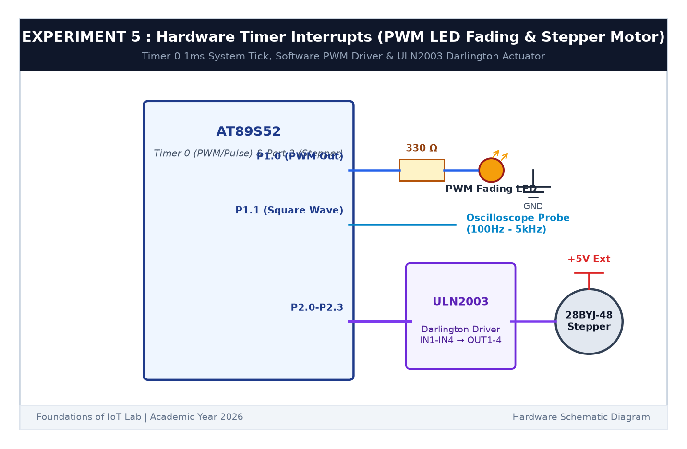

# EXPERIMENT DETAILS

**EXP:** CONTINUOUS ASSESSMENT 5  

**DATE:** 10/08/2026  

**NAME OF EXP:** Hardware Timer and Interrupt-Based Timing for LED Fading, Pulse Generation, and Stepper Motor Control  

**HARDWARE SETUP / PLATFORM:** AT89S52 Microcontroller Development Board + 28BYJ-48 5V Stepper Motor + ULN2003 Darlington Array Driver Module + Digital Storage Oscilloscope (DSO) + Keil µVision C51  

---

## TASK 5A : Hardware Timer 0 Interrupt & Time Base Generation

### 1. Circuit Diagram

The circuit uses Timer 0 interrupt to drive a software PWM LED, a variable frequency pulse output, and a 4-phase unipolar stepper motor via ULN2003.

- **Microcontroller:** AT89S52
- **Oscillator Frequency:** $f_{crystal} = 11.0592	ext{ MHz}$
- **Machine Cycle Time:** $T_{machine} = rac{12}{f_{crystal}} = rac{12}{11.0592 	imes 10^6} pprox 1.0851\,\mu	ext{s}$
- **Desired Tick Period:** $1	ext{ ms} = 1000\,\mu	ext{s}$
- **Count Increments ($N$):** $N = rac{1000\,\mu	ext{s}}{1.0851\,\mu	ext{s}} pprox 922	ext{ counts}$
- **16-bit Timer Preload Value:** $65536 - 922 = 64614 = 	ext{0xFC66}$ (`TH0 = 0xFC`, `TL0 = 0x66`)

---

## TASK 5B : Software PWM LED Fading (0% to 100%)

### 1. Core Logic & Duty Cycle Mapping

Using the 1 ms hardware interrupt timebase, software PWM is generated with a period of 10 ms (100 Hz). The duty cycle is incremented from 0% (OFF) to 100% (Full Brightness) in discrete steps and decremented back, generating smooth continuous fading without visible flicker.

| Duty Cycle | PWM State | Perceived Brightness |
|:---:|:---:|---|
| **0%** | Continuously LOW | OFF |
| **25%** | 2.5 ms HIGH / 7.5 ms LOW | Dim |
| **50%** | 5.0 ms HIGH / 5.0 ms LOW | Medium Brightness |
| **75%** | 7.5 ms HIGH / 2.5 ms LOW | Bright |
| **100%** | Continuously HIGH | Maximum Luminosity |

---

## TASK 5C : Stepper Motor Speed & Direction Control

### 1. Working Principle

The 28BYJ-48 unipolar stepper motor has 4 stator coils driven through a ULN2003 Darlington transistor array connected to pins `P2.0` - `P2.3`. The software executes a 4-step excitation sequence:

$$	ext{Step 1: } 1000_2 (0x08) 	o 	ext{Step 2: } 0100_2 (0x04) 	o 	ext{Step 3: } 0010_2 (0x02) 	o 	ext{Step 4: } 0001_2 (0x01)$$

- **Slow Speed:** 100 ms/step
- **Medium Speed:** 50 ms/step
- **Fast Speed:** 10 ms/step

### 2. Code Base

Fully implemented in `main.c` utilizing Timer 0 interrupt vector `interrupt 1`.

### 3. Inference

The 16-bit hardware timer eliminated CPU-blocking delay loops, allowing concurrent execution of PWM dimming, square wave generation, and stepper motor coil commutation. Waveform timing and frequency were experimentally confirmed on the oscilloscope.
