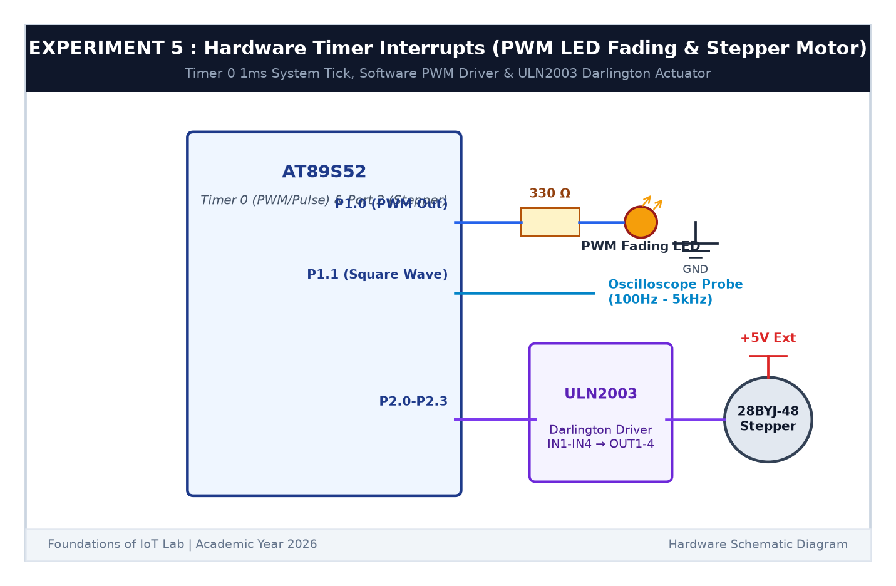

# EXPERIMENT DETAILS

**EXP:** CONTINUOUS ASSESSMENT 5  

**DATE:** 10/08/2026  

**NAME OF EXP:** Hardware Timer and Interrupt-Based Timing for LED Fading, Pulse Generation, and Stepper Motor Control  

**HARDWARE SETUP / PLATFORM:** AT89S52 Microcontroller Board + Keil µVision C51 + Oscilloscope  

---

## TASK 5A : Hardware Timer 0 Interrupt 1ms Time Base

### 1. Circuit Diagram

This task configures Timer 0 in 16-bit Mode 1 to generate an exact 1 ms periodic interrupt without CPU blocking.

- **Microcontroller:** AT89S52 @ 11.0592 MHz
- **Timer 0 Mode:** Mode 1 (16-bit Timer)
- **Preload Calculation:**
  $$	ext{Cycle Time} = rac{12}{11.0592	ext{ MHz}} = 1.085\,\mu	ext{s}$$
  $$	ext{Ticks for 1 ms} = rac{1000\,\mu	ext{s}}{1.085\,\mu	ext{s}} pprox 922	ext{ ticks}$$
  $$	ext{Preload} = 65536 - 922 = 64614 = 	ext{0xFC66}$$
  $$\implies 	ext{TH0} = 	ext{0xFC},\quad 	ext{TL0} = 	ext{0x66}$$

### 2. Core Logic

1. In `TMOD`, set Timer 0 to Mode 1 (`TMOD = 0x01`).
2. Load `TH0 = 0xFC` and `TL0 = 0x66`.
3. Enable Timer 0 interrupt and global interrupts: `ET0 = 1; EA = 1; TR0 = 1;`.
4. In ISR `void timer0_isr(void) interrupt 1`, reload `TH0` and `TL0`, increment a global millisecond tick counter, and toggle a test pin.

### 3. Inference

Oscilloscope verification confirmed that Timer 0 triggered every 1.00 ms, creating an accurate hardware time base for concurrent tasks.
