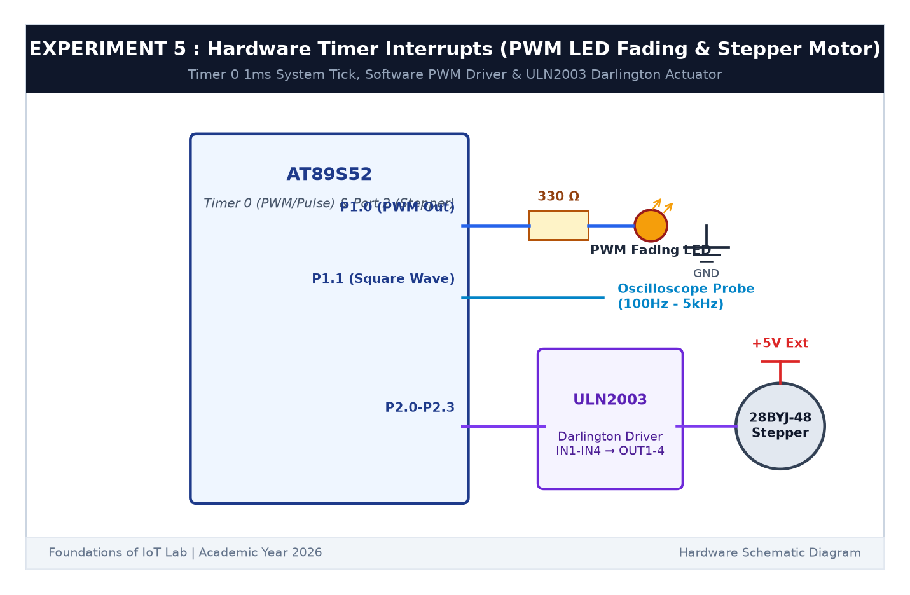

# EXPERIMENT DETAILS

**EXP:** CONTINUOUS ASSESSMENT 5  

**DATE:** 10/08/2026  

**NAME OF EXP:** Hardware Timer and Interrupt-Based Timing for LED Fading, Pulse Generation, and Stepper Motor Control  

**HARDWARE SETUP / PLATFORM:** AT89S52 Microcontroller Board + Indicator LED + 330Ω Resistor + Keil µVision C51  

---

## TASK 5B : Software PWM LED Fading (0% to 100%)

### 1. Circuit Diagram

This task implements pulse-width modulation in software using the 1 ms timer interrupt to smoothly dim an LED.

- **Microcontroller:** AT89S52
- **PWM Output Pin:** `P1.0` connected to an LED in series with a 330Ω resistor to Ground

### 2. PWM Principle & Fading Algorithm

1. A 100 Hz PWM frame is divided into 10 steps of 1 ms each.
2. In each 1 ms timer tick, an internal counter increments from 0 to 9.
3. If `counter < duty_cycle`, the LED pin is set HIGH; otherwise, it is set LOW.
4. Every 50 ms, `duty_cycle` increments from 0 to 10 (0% to 100%) and then decrements back to 0, producing a breathing LED fading effect.

### 3. Inference

The LED faded smoothly between fully off and maximum brightness without visible flicker, validating the software PWM implementation.
