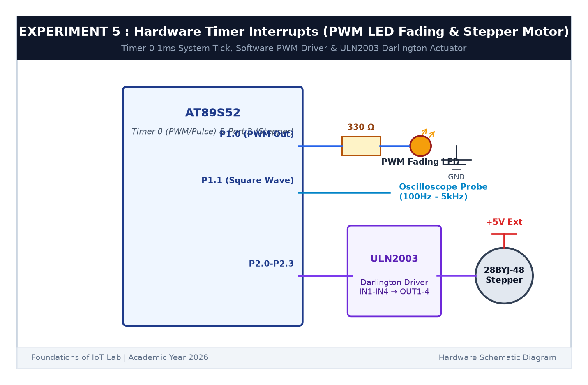

# EXPERIMENT DETAILS

**EXP:** CONTINUOUS ASSESSMENT 5  

**DATE:** 10/08/2026  

**NAME OF EXP:** Hardware Timer and Interrupt-Based Timing for LED Fading, Pulse Generation, and Stepper Motor Control  

**HARDWARE SETUP / PLATFORM:** AT89S52 Microcontroller Board + 28BYJ-48 Stepper Motor + ULN2003 Darlington Driver + Keil µVision C51  

---

## TASK 5C : Stepper Motor Commutation & Speed Control

### 1. Circuit Diagram

This task drives a 4-phase unipolar stepper motor using a ULN2003 driver connected to Port 2.

- **Microcontroller:** AT89S52
- **Driver Inputs (IN1-IN4):** `P2.0`, `P2.1`, `P2.2`, `P2.3`
- **Driver:** ULN2003 Darlington transistor array powered from external +5V
- **Motor:** 28BYJ-48 5V unipolar stepper motor

### 2. 4-Step Commutation Sequence

The stepper motor coils are energized sequentially:
$$	ext{Step 1: } 1000_2 (	ext{0x08}) 	o 	ext{Step 2: } 0100_2 (	ext{0x04}) 	o 	ext{Step 3: } 0010_2 (	ext{0x02}) 	o 	ext{Step 4: } 0001_2 (	ext{0x01})$$
- Speed is controlled non-blockingly by adjusting the step interval (10 ms for fast, 50 ms for medium, 100 ms for slow).
- Reversing the sequence reverses the motor direction.

### 3. Inference

The stepper motor rotated smoothly in both forward and reverse directions. Changing step intervals modified the shaft rotation speed accurately.
