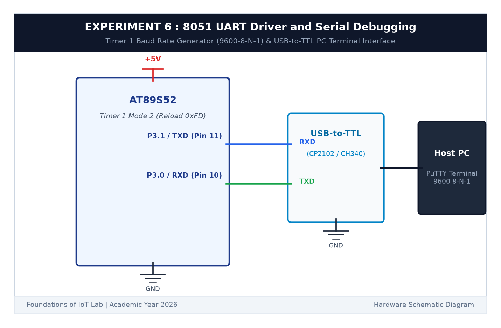

# EXPERIMENT DETAILS

**EXP:** CONTINUOUS ASSESSMENT 6  

**DATE:** 17/08/2026  

**NAME OF EXP:** UART Driver and Serial Debugging  

**HARDWARE SETUP / PLATFORM:** AT89S52 Microcontroller Board + CP2102 USB-to-TTL Serial Converter + PC with PuTTY Serial Terminal + Keil µVision C51  

---

## TASK 6A & 6B : UART Driver & Interactive Terminal Echo

### 1. Circuit Diagram

The circuit connects the hardware UART of the 8051 to a laptop via a USB-to-TTL serial module.

- **Microcontroller:** AT89S52 (11.0592 MHz crystal)
- **TXD Pin:** `P3.1` (Pin 11) connected to USB-TTL `RXD`
- **RXD Pin:** `P3.0` (Pin 10) connected to USB-TTL `TXD`
- **Ground:** Common ground between 8051 and USB-TTL
- **PC Serial Settings:** 9600 Baud, 8 Data Bits, 1 Stop Bit, No Parity (9600-8-N-1)

### 2. Baud Rate Calculation for 9600 Baud

Using Timer 1 in Mode 2 (8-bit auto-reload) with an 11.0592 MHz crystal:
$$	ext{Baud Rate} = rac{f_{osc}}{32 	imes 12 	imes (256 - TH1)} = rac{28800}{256 - TH1}$$
$$9600 = rac{28800}{256 - TH1} \implies 256 - TH1 = 3 \implies TH1 = 253 = 	ext{0xFD}$$
Setting `TH1 = 0xFD` produces exactly 9600 baud with **0% timing error**.

### 3. Core Logic / Working Principle

1. **Initialization:** Set Timer 1 to Mode 2 (`TMOD = 0x20`), reload `TH1 = 0xFD`, start the timer (`TR1 = 1`), and configure `SCON = 0x50` (Mode 1, Receiver Enabled).
2. **Transmission:** When sending a byte, we write it to `SBUF` and wait for the `TI` flag to become `1`.
3. **Interactive Echo:** When a character is typed into PuTTY on the PC, the 8051 UART receives it, triggers the receive interrupt (`RI = 1`), stores it in a circular ring buffer, and immediately transmits the character back so it appears on the PuTTY screen.

### 4. Inference

The 8051 established clean, bi-directional communication with the PC terminal at 9600 baud. The text "Hello from 8051!" was received accurately, and every key typed in PuTTY echoed back instantly without dropped characters.
