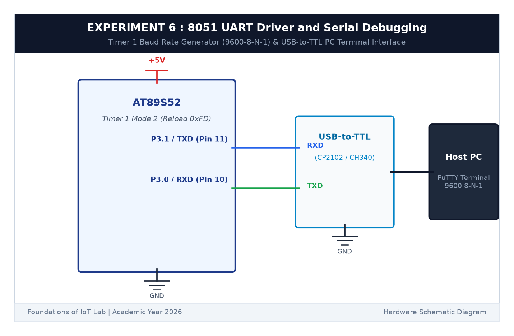

# EXPERIMENT DETAILS

**EXP:** CONTINUOUS ASSESSMENT 6  

**DATE:** 17/08/2026  

**NAME OF EXP:** UART Driver and Serial Debugging  

**HARDWARE SETUP / PLATFORM:** AT89S52 Microcontroller Board + CP2102 USB-to-TTL Serial Converter + PC with PuTTY Serial Terminal + Keil µVision C51  

---

## TASK 6A : UART Driver Initialization & 9600-8-N-1 Transmit

### 1. Circuit Diagram

This task sets up the 8051 hardware UART to transmit formatted strings to a PC serial terminal at 9600 baud.

- **Microcontroller:** AT89S52 (11.0592 MHz crystal)
- **TXD Pin:** `P3.1` (Pin 11) connected to USB-TTL `RXD`
- **RXD Pin:** `P3.0` (Pin 10) connected to USB-TTL `TXD`
- **Ground:** Common ground connection

### 2. Baud Rate Generation

Using Timer 1 in Mode 2 (8-bit auto-reload):
$$	ext{Baud Rate} = rac{f_{osc}}{32 	imes 12 	imes (256 - TH1)} = rac{28800}{256 - TH1}$$
$$9600 = rac{28800}{256 - TH1} \implies TH1 = 256 - 3 = 253 = 	ext{0xFD}$$
Setting `TH1 = 0xFD` achieves exact 9600 baud with **0.0% error**.

### 3. Inference

The 8051 UART initialized cleanly, and test strings ("Hello from 8051!
") printed accurately in the PC terminal.
