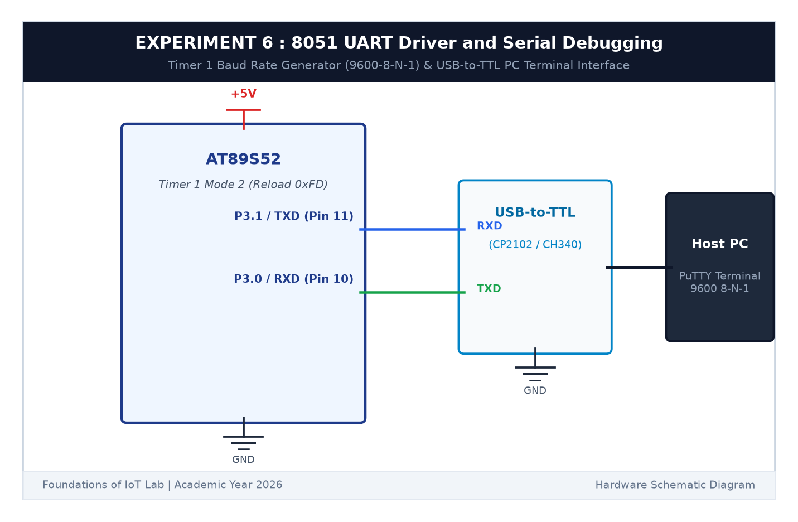

# EXPERIMENT DETAILS

**EXP:** CONTINUOUS ASSESSMENT 6  

**DATE:** 17/08/2026  

**NAME OF EXP:** UART Driver and Serial Debugging  

**HARDWARE SETUP / PLATFORM:** AT89S52 Microcontroller Board + CP2102 USB-to-TTL Serial Converter + PC with PuTTY Serial Terminal + Keil µVision C51  

---

## TASK 6B : Interactive PuTTY Terminal Echo & RX Ring Buffer

### 1. Circuit Diagram

This task implements interrupt-driven serial reception and immediate character echo back to the terminal.

- **Microcontroller:** AT89S52
- **Serial Pins:** `P3.0` (RXD), `P3.1` (TXD)
- **Terminal Config:** 9600 Baud, 8-N-1, No Flow Control

### 2. Core Logic

1. Enable serial interrupt `ES = 1` and global interrupts `EA = 1`.
2. When a character is typed into PuTTY, the 8051 triggers `serial_isr() interrupt 4`.
3. If `RI == 1`, read byte from `SBUF`, clear `RI`, and place into a circular ring buffer.
4. Immediately transmit the received character back to `SBUF` and wait for `TI == 1`.

### 3. Inference

Every keystroke in the PuTTY terminal echoed back in real-time without latency or dropped bytes, verifying full-duplex asynchronous serial communication.
