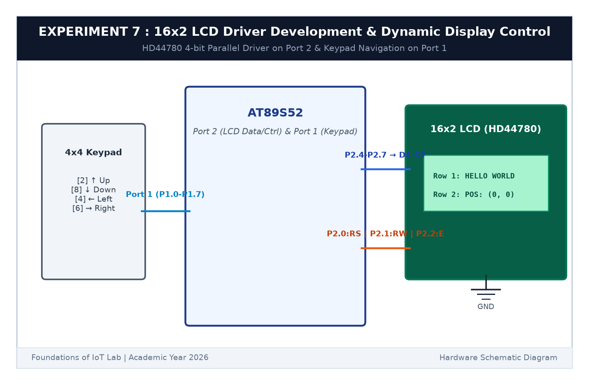

# EXPERIMENT DETAILS

**EXP:** CONTINUOUS ASSESSMENT 7  

**DATE:** 24/08/2026  

**NAME OF EXP:** 16x2 LCD Driver Development and Dynamic Display Control  

**HARDWARE SETUP / PLATFORM:** AT89S52 Microcontroller Board + 16x2 HD44780 LCD Display + 10kΩ Potentiometer + 4x4 Keypad + Keil µVision C51  

---

## TASK 7A, 7B & 7C : 4-Bit LCD Driver & Keypad Character Movement

### 1. Circuit Diagram

The circuit interfaces an alphanumeric 16x2 LCD in 4-bit mode to save I/O pins, and connects a 4x4 keypad to Port 1 for directional control.

- **Microcontroller:** AT89S52
- **LCD Control Lines:** `RS` (Register Select) on `P2.0`, `RW` (Read/Write) on `P2.1`, `E` (Enable) on `P2.2`
- **LCD Data Lines (4-Bit):** `D4` to `D7` connected to `P2.4` to `P2.7`
- **Contrast Adjustment:** 10kΩ potentiometer wiper connected to pin `V0`
- **4x4 Keypad:** Connected to Port 1 (`P1.0`-`P1.7`) for interactive directional navigation

### 2. Working Principle & 4-Bit Data Transmission

1. **Why 4-Bit Mode?** In 8-bit mode, 8 data wires plus 3 control wires are needed (11 pins). In 4-bit mode, each 8-bit command or ASCII character is split into two 4-bit nibbles (high nibble first, then low nibble), needing only 4 data pins and saving pins for other peripherals.
2. **Initialization Sequence:** The LCD is initialized with commands `0x28` (4-bit, 2-line mode), `0x0C` (Display ON, cursor OFF), `0x06` (Increment cursor), and `0x01` (Clear display).
3. **Interactive Character Mover:**
   - We place a character `'A'` on the screen.
   - When Key `2` is pressed, `'A'` moves Up (`row = 0`).
   - When Key `8` is pressed, `'A'` moves Down (`row = 1`).
   - When Key `4` is pressed, `'A'` moves Left (`col--`).
   - When Key `6` is pressed, `'A'` moves Right (`col++`).
   - Before moving, the previous position is cleared with a space `' '`.

### 3. Inference

The 4-bit parallel LCD driver initialized properly and displayed text clearly on both lines. The contrast potentiometer let us fine-tune text visibility, and the character 'A' navigated cleanly across the 16x2 grid in response to directional keypad inputs.
