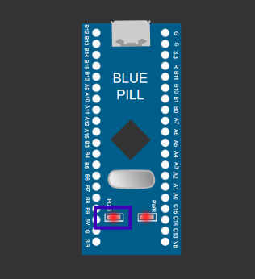

# EXPERIMENT DETAILS

**EXP:** CONTINUOUS ASSESSMENT 7  

**DATE:** 24/08/2026  

**NAME OF EXP:** 16x2 LCD Driver Development and Dynamic Display Control  

**HARDWARE SETUP / PLATFORM:** AT89S52 MCU + 16x2 HD44780 LCD Display + 10kΩ Potentiometer + Keil µVision C51  

---

## TASK 7A : 4-Bit Parallel LCD Driver Implementation

### 1. Circuit Diagram

The 16x2 LCD is interfaced in 4-bit mode: RS on P2.0, RW on P2.1, E on P2.2, and data lines D4-D7 on P2.4-P2.7.



### 2. Core Logic / Pseudocode / Code Base

**Working Principle:**
Using 4-bit mode saves I/O pins by splitting each command into high and low nibbles sent sequentially with enable pulses.

**Pseudocode:**
1. Send high nibble on P2.4-P2.7 and pulse E.
2. Send low nibble and pulse E.
3. Send initialization commands (0x28, 0x0C, 0x06, 0x01).

**Code Base (`main.c`):**
```c
#include <reg51.h>

sbit RS = P2^0;
sbit RW = P2^1;
sbit E  = P2^2;

void delay_ms(unsigned int ms) {
    unsigned int i, j;
    for (i = 0; i < ms; i++) for (j = 0; j < 120; j++);
}

void lcd_pulse(void) {
    E = 1; delay_ms(2); E = 0; delay_ms(2);
}

void lcd_cmd(unsigned char cmd) {
    RS = 0; RW = 0;
    P2 = (P2 & 0x0F) | (cmd & 0xF0); lcd_pulse();
    P2 = (P2 & 0x0F) | ((cmd << 4) & 0xF0); lcd_pulse();
}

void lcd_data(unsigned char d) {
    RS = 1; RW = 0;
    P2 = (P2 & 0x0F) | (d & 0xF0); lcd_pulse();
    P2 = (P2 & 0x0F) | ((d << 4) & 0xF0); lcd_pulse();
}

void lcd_init(void) {
    delay_ms(20);
    lcd_cmd(0x28);
    lcd_cmd(0x0C);
    lcd_cmd(0x06);
    lcd_cmd(0x01);
}

void main(void) {
    lcd_init();
    lcd_data('O'); lcd_data('K');
    while (1);
}

```

### 3. Inference

The LCD initialized properly and cleared its screen in 4-bit mode using only 7 microcontroller pins.
