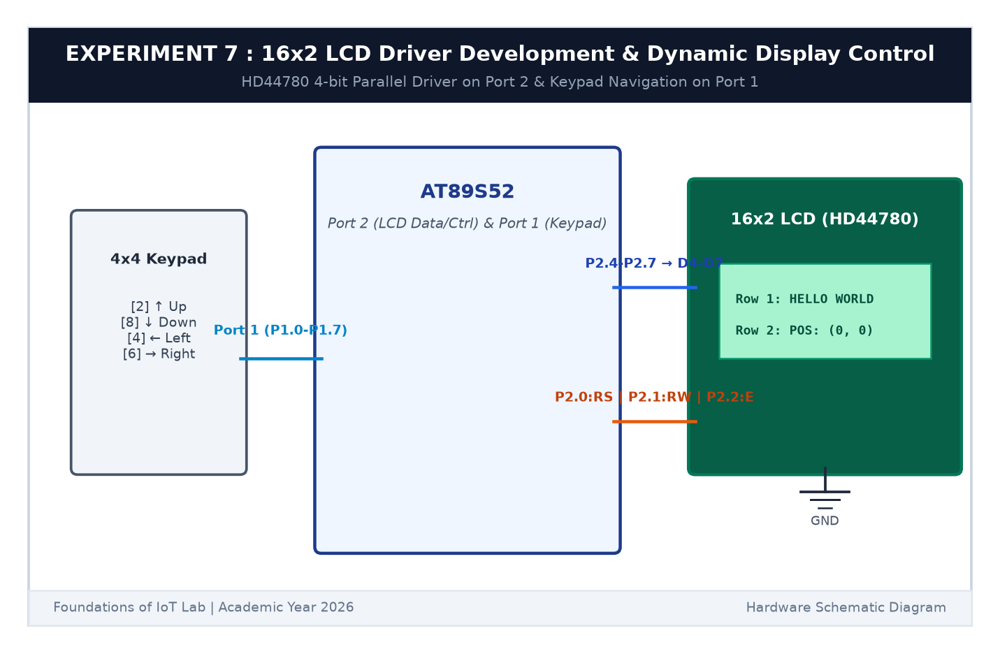

# EXPERIMENT DETAILS

**EXP:** CONTINUOUS ASSESSMENT 7  

**DATE:** 24/08/2026  

**NAME OF EXP:** 16x2 LCD Driver Development and Dynamic Display Control  

**HARDWARE SETUP / PLATFORM:** AT89S52 Microcontroller Board + 16x2 HD44780 LCD Display + 10kΩ Potentiometer + Keil µVision C51  

---

## TASK 7A : 4-Bit Parallel LCD Driver Implementation

### 1. Circuit Diagram

This task builds a 4-bit parallel driver for the industry-standard HD44780 LCD to conserve microcontroller I/O pins.

- **Microcontroller:** AT89S52
- **Control Lines:** `RS` (Register Select) on `P2.0`, `RW` on `P2.1`, `E` (Enable) on `P2.2`
- **Data Lines:** `D4`-`D7` connected to `P2.4`-`P2.7`
- **Contrast:** 10kΩ potentiometer wiper connected to `V0` (Pin 3)

### 2. 4-Bit Transmission Principle

Every 8-bit command or data byte is split into two 4-bit transfers:
1. Send upper 4 bits (`D7`-`D4`) to `P2.4`-`P2.7` and pulse `E` HIGH-to-LOW.
2. Send lower 4 bits (`D3`-`D0`) to `P2.4`-`P2.7` and pulse `E` HIGH-to-LOW.
3. Initialization commands sent: `0x28` (4-bit, 2-line mode), `0x0C` (Display ON, cursor OFF), `0x06` (Entry mode auto-increment), `0x01` (Clear display).

### 3. Inference

The 16x2 LCD initialized reliably in 4-bit mode using only 7 total GPIO pins, clearing the display ready for alphanumeric characters.
