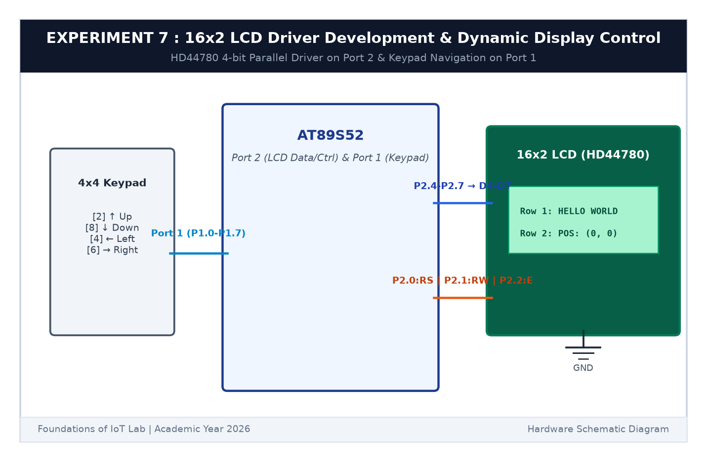

# EXPERIMENT DETAILS

**EXP:** CONTINUOUS ASSESSMENT 7  

**DATE:** 24/08/2026  

**NAME OF EXP:** 16x2 LCD Driver Development and Dynamic Display Control  

**HARDWARE SETUP / PLATFORM:** AT89S52 Microcontroller Board + 16x2 HD44780 LCD Display + Keil µVision C51  

---

## TASK 7B : Alphanumeric String Display & Cursor Positioning

### 1. Circuit Diagram

This task implements cursor positioning functions `lcd_goto(row, col)` and string transmission functions.

- **Microcontroller:** AT89S52
- **LCD Interface:** 4-bit mode on Port 2

### 2. DDRAM Address Mapping

- Line 1 addresses: `0x80` to `0x8F` (Columns 0 to 15)
- Line 2 addresses: `0xC0` to `0xCF` (Columns 0 to 15)
- Function `lcd_goto(row, col)` sends command `(row == 0 ? 0x80 : 0xC0) + col`.
- Strings are printed by iterating through null-terminated character arrays.

### 3. Inference

Text printed cleanly across both lines of the LCD at designated row and column coordinates.
