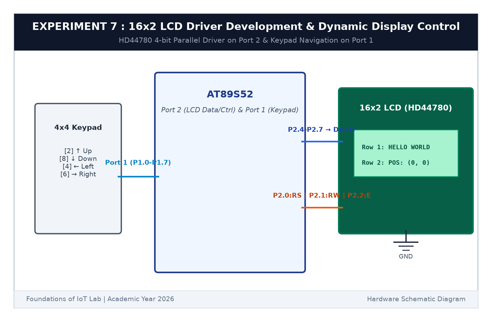

# EXPERIMENT DETAILS

**EXP:** CONTINUOUS ASSESSMENT 7  

**DATE:** 24/08/2026  

**NAME OF EXP:** 16x2 LCD Driver Development and Dynamic Display Control  

**HARDWARE SETUP / PLATFORM:** AT89S52 Microcontroller Board + 16x2 HD44780 LCD + 4x4 Matrix Keypad + Keil µVision C51  

---

## TASK 7C : Keypad Controlled Interactive Character Navigation

### 1. Circuit Diagram

This task enables interactive character navigation across the 16x2 LCD grid in response to 4x4 keypad presses.

- **Microcontroller:** AT89S52
- **LCD:** Connected to Port 2 (`P2.0`-`P2.7`)
- **Keypad:** Connected to Port 1 (`P1.0`-`P1.7`)

### 2. Directional Key Mapping

- **Key 2:** Move UP (`row = 0`)
- **Key 8:** Move DOWN (`row = 1`)
- **Key 4:** Move LEFT (`col--`, with boundary check at 0)
- **Key 6:** Move RIGHT (`col++`, with boundary check at 15)
- Before redrawing the character at the new coordinate, the previous position is cleared with a space character `' '`.

### 3. Inference

The character navigated smoothly across all 32 grid cells of the 16x2 display according to user directional inputs.
