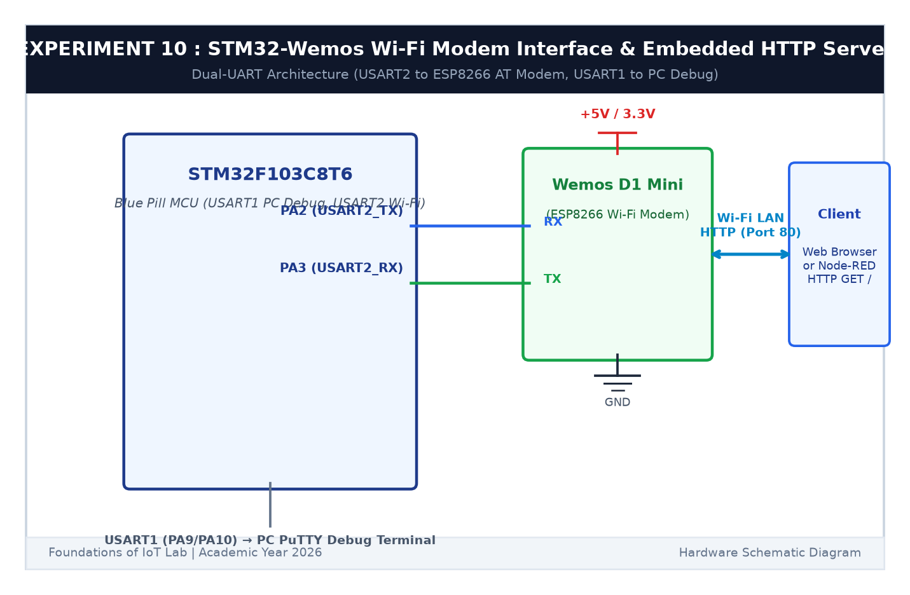

# EXPERIMENT DETAILS

**EXP:** CONTINUOUS ASSESSMENT 10  

**DATE:** 05/10/2026 & 12/10/2026 (Weeks 9 & 10)  

**NAME OF EXP:** STM32–Wemos Wi-Fi Modem Interface Using AT Commands & Embedded HTTP Server  

**HARDWARE SETUP / PLATFORM:** STM32 Blue Pill Board (STM32F103C8T6) + Wemos D1 Mini (ESP8266 Wi-Fi Module) + USB-TTL Serial Debugger + Node-RED Local Gateway + Keil MDK-ARM + STM32CubeMX  

---

## TASK 10A & 10B : Dual-UART Bridging & AT Command Investigation

### 1. Circuit Diagram

The STM32 microcontroller coordinates two simultaneous asynchronous serial peripherals: `USART2` communicating directly with the ESP8266 AT firmware, and `USART1` acting as the live debugging bridge to the host PC.

- **Microcontroller:** STM32F103C8T6
- **Wi-Fi Modem:** Wemos D1 Mini / ESP8266 SoC
- **Modem Interface (USART2):** `PA2` (TX) $	o$ Wemos `RX`, `PA3` (RX) $\leftarrow$ Wemos `TX` @ 115200 baud
- **PC Debug Interface (USART1):** `PA9` (TX) $	o$ USB-TTL `RX`, `PA10` (RX) $\leftarrow$ USB-TTL `TX` @ 115200 baud
- **Modem Power:** +5V / +3.3V DC and Common GND



### 2. AT Command Interface Protocol

| Command Sent | Purpose | Expected Modem Response |
|---|---|---|
| `AT` | Ping modem & test baud rate | `OK` |
| `AT+GMR` | Query firmware & SDK version | SDK version & `OK` |
| `AT+CWMODE=1` | Set Wi-Fi to Station (Client) Mode | `OK` |
| `AT+CWLAP` | Scan for local wireless Access Points | List of AP SSIDs & signal strengths |
| `AT+CWJAP="SSID","PASS"` | Connect to local Wi-Fi router | `WIFI CONNECTED
WIFI GOT IP
OK` |
| `AT+CIFSR` | Query assigned Station IP address | `+CIFSR:STAIP,"192.168.1.105"` |

---

## TASK 10C, 10D & 10E : TCP Server, HTTP Response Transmission & Node-RED

### 1. Working Principle

1. **TCP Server Activation:** The ESP8266 is placed into multi-connection mode (`AT+CIPMUX=1`) and listening socket opened on standard HTTP port 80 (`AT+CIPSERVER=1,80`).
2. **Parsing `+IPD` Frames:** When a web browser or Node-RED makes a `GET / HTTP/1.1` request, the ESP8266 emits an asynchronous packet notification:
   `+IPD,<link_id>,<data_len>:GET / HTTP/1.1...`
3. **Two-Step HTTP Response:**
   - **Step 1:** Issue transmission command with exact payload size:
     `sprintf(cmd, "AT+CIPSEND=%d,%d
", link_id, total_bytes);`
   - **Step 2:** Transmit formatted HTTP string containing header and HTML body:
     ```text
     HTTP/1.1 200 OK

     Content-Type: text/html

     Content-Length: 124

     Connection: close

     

     <html><body><h1>STM32 IoT Node</h1></body></html>
     ```
4. **Node-RED Client:** An `inject` node triggers an `http request` node targeting `http://<ESP_IP>:80/`. The returned HTML payload is visualized directly in the Node-RED debug panel.

### 2. Node-RED Configuration (`node_red_http_flow.json`)

```json
[
  {"id":"http_inject","type":"inject","name":"Poll STM32 HTTP Server","repeat":"5","wires":[["stm32_http_req"]]},
  {"id":"stm32_http_req","type":"http request","method":"GET","url":"http://192.168.1.105:80/","wires":[["http_debug"]]},
  {"id":"http_debug","type":"debug","name":"Display HTTP Response","wires":[]}
]
```

### 3. Inference

The dual-UART bridge enabled transparent firmware command interaction with the ESP8266. The STM32 successfully handled TCP socket lifecycles, accurately measured HTTP string lengths for `AT+CIPSEND`, and rendered dynamic sensor webpages to both Chrome web browsers and Node-RED flows.
