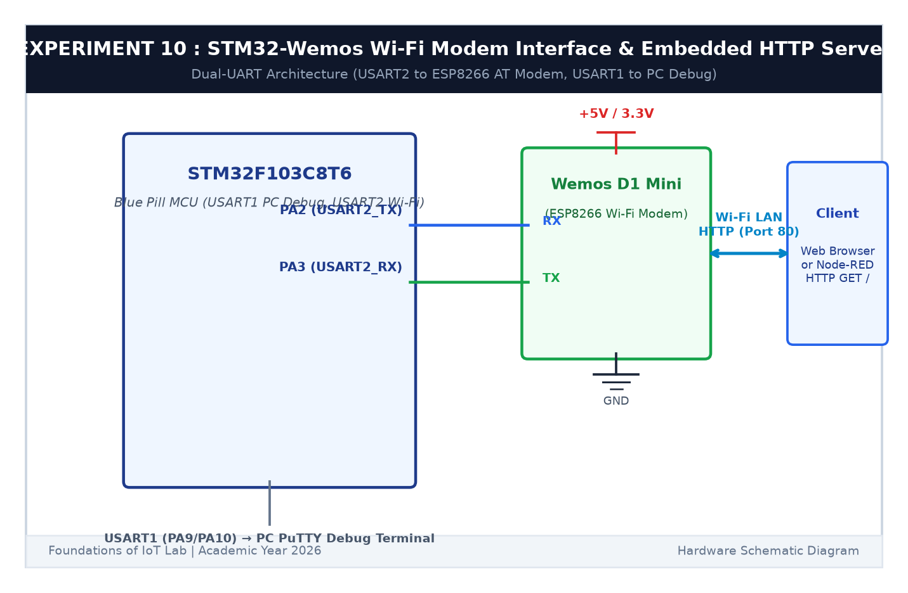

# EXPERIMENT DETAILS

**EXP:** CONTINUOUS ASSESSMENT 10  

**DATE:** 05/10/2026 & 12/10/2026  

**NAME OF EXP:** STM32–Wemos Wi-Fi Modem Interface Using AT Commands & Embedded HTTP Server  

**HARDWARE SETUP / PLATFORM:** STM32 Blue Pill Board (STM32F103C8T6) + Wemos D1 Mini (ESP8266) + USB-TTL Serial Debugger + Keil MDK-ARM + STM32CubeMX  

---

## TASK 10A & 10B : Dual-UART Bridging & AT Commands

### 1. Circuit Diagram

This task sets up a dual-UART bridge to communicate with and configure the ESP8266 Wi-Fi modem.

- **Microcontroller:** STM32F103C8T6
- **USART1 (`PA9`/`PA10`):** Connected to PC via USB-TTL at 115200 baud for debugging.
- **USART2 (`PA2`/`PA3`):** Connected to Wemos D1 Mini (`RX`/`TX`) at 115200 baud.
- **Power:** 3.3V and common ground.

### 2. AT Commands Tested

- `AT`: Checks modem communication (`OK`).
- `AT+CWMODE=1`: Configures Wi-Fi Station Mode.
- `AT+CWJAP="SSID","PASS"`: Connects to local Wi-Fi router.
- `AT+CIFSR`: Retrieves local IP address.

### 3. Inference

The STM32 bridged communications between PC terminal and ESP8266, verifying all fundamental AT modem setup commands.
