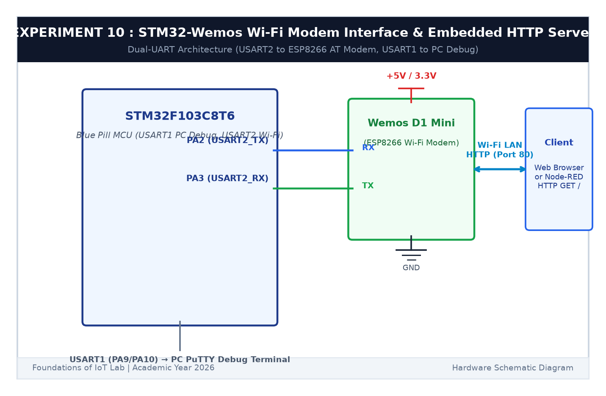

# EXPERIMENT DETAILS

**EXP:** CONTINUOUS ASSESSMENT 10  

**DATE:** 05/10/2026 & 12/10/2026  

**NAME OF EXP:** STM32–Wemos Wi-Fi Modem Interface Using AT Commands & Embedded HTTP Server  

**HARDWARE SETUP / PLATFORM:** STM32 Blue Pill Board + Wemos D1 Mini + Keil MDK-ARM + STM32CubeMX  

---

## TASK 10C & 10D : TCP Server & Embedded HTTP Web Server

### 1. Circuit Diagram

This task configures the ESP8266 as a TCP server on port 80 and processes HTTP GET requests from web browsers.

- **Microcontroller:** STM32F103C8T6
- **Modem:** Wemos D1 Mini (ESP8266) via USART2
- **Actuator:** On-board LED on `PC13`

### 2. HTTP Request & Response Handling

1. Configure server: `AT+CIPMUX=1` followed by `AT+CIPSERVER=1,80`.
2. When a browser visits the IP, the ESP8266 delivers `+IPD,<id>,<len>:GET / HTTP/1.1`.
3. If path contains `/led/on`, `PC13` is set LOW (LED ON).
4. If path contains `/led/off`, `PC13` is set HIGH (LED OFF).
5. The STM32 sends back an HTTP 200 response with an HTML webpage indicating current LED status.

### 3. Inference

The embedded HTTP server responded to web requests, allowing users to toggle the physical LED directly from a web browser.
