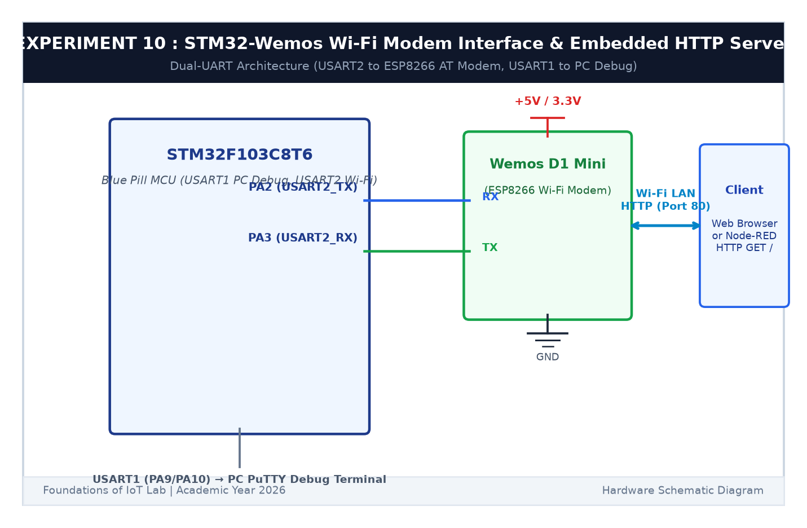

# EXPERIMENT DETAILS

**EXP:** CONTINUOUS ASSESSMENT 10  

**DATE:** 05/10/2026 & 12/10/2026  

**NAME OF EXP:** STM32–Wemos Wi-Fi Modem Interface Using AT Commands & Embedded HTTP Server  

**HARDWARE SETUP / PLATFORM:** STM32 Blue Pill + Wemos D1 Mini + Node-RED Local Gateway  

---

## TASK 10E : Node-RED Local Gateway Integration

### 1. Circuit Diagram

This task connects a local Node-RED dashboard to the STM32 embedded HTTP server.

- **Microcontroller:** STM32F103C8T6 + ESP8266 Wi-Fi
- **Gateway:** Node-RED running on local PC

### 2. Node-RED HTTP Flow

The flow file `node_red_http_flow.json` configures:
- **Button Node "Turn LED ON":** Sends `GET http://<ESP_IP>/led/on`.
- **Button Node "Turn LED OFF":** Sends `GET http://<ESP_IP>/led/off`.
- **Debug Node:** Displays HTTP response status in the Node-RED sidebar.

### 3. Inference

Node-RED acted as a client to the STM32 web server, toggling the physical LED over the local network with low latency.
