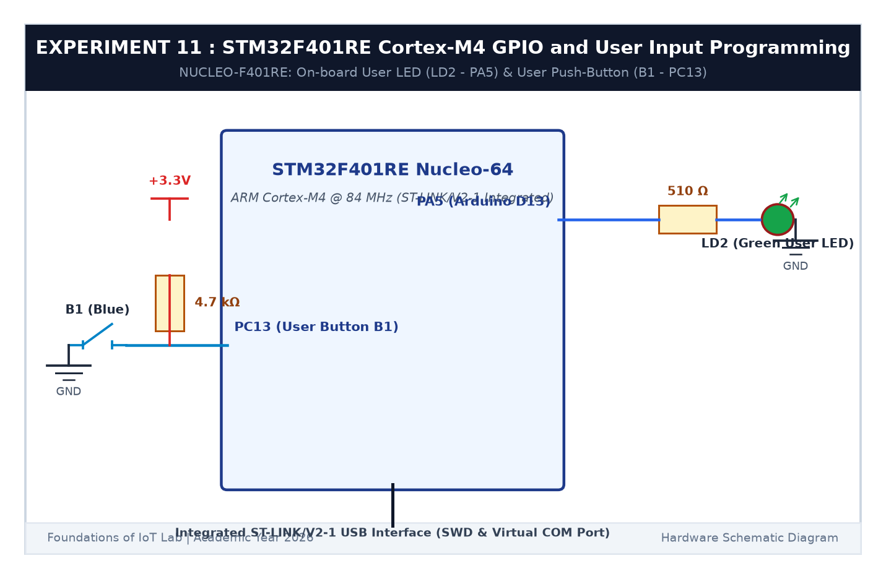

# EXPERIMENT DETAILS

**EXP:** CONTINUOUS ASSESSMENT 11  

**DATE:** 14/10/2026  

**NAME OF EXP:** STM32F401RE Cortex-M4: GPIO and User Input Programming  

**HARDWARE SETUP / PLATFORM:** STMicroelectronics NUCLEO-F401RE Development Board (ARM Cortex-M4 with FPU @ 84 MHz) + Integrated ST-LINK/V2-1 + Keil MDK-ARM + STM32CubeMX  

---

## TASK 1 & 2 : On-board LED Bring-Up & Switch State Remembrance

### 1. Circuit Diagram

The experiment utilizes the integrated user peripherals on the STM32 Nucleo-64 development board.

- **Development Platform:** NUCLEO-F401RE
- **Processor Core:** ARM 32-bit Cortex-M4 with FPU @ 84 MHz
- **On-board User LED (LD2):** Green LED connected to pin `PA5` (Arduino connector D13 compatible, Active HIGH)
- **On-board User Button (B1):** Blue tactile switch connected to `PC13` with hardware pull-up resistor to 3.3V (Active LOW)
- **Debugger Interface:** On-board ST-LINK/V2-1 supporting SWD in-circuit programming and Virtual COM port

### 2. State Remembrance Logic

When button B1 is actuated, the controller identifies the falling edge (`PC13 == GPIO_PIN_RESET`). Upon release (`PC13 == GPIO_PIN_SET`), the system toggles `PA5` via `HAL_GPIO_TogglePin()`. The LED retains its updated state indefinitely after release until the next valid event.

---

## TASK 3 : Short-Press vs Long-Press Detection

### 1. Timing Specification

| Input Event | Pulse Duration Threshold | Target Firmware Response |
|---|---|---|
| **Short Press** | $40	ext{ ms} \le \Delta t < 1000	ext{ ms}$ | Invert current LED state (`HAL_GPIO_TogglePin`) |
| **Long Press** | $\Delta t \ge 1000	ext{ ms}$ | Activate continuous 5 Hz fast alert blink mode |
| **Subsequent Short Press** | $< 1000	ext{ ms}$ | Terminate blink mode and return to static state |

### 2. Code Base

Implemented in `Core/Src/main.c` utilizing ARM Cortex-M4 SysTick timestamp delta calculations (`HAL_GetTick()`).

### 3. Inference

The Cortex-M4 GPIO peripheral initialized seamlessly via STM32 HAL drivers. The non-blocking duration classifier accurately captured transient switch actuations and sustained holds without blocking concurrent CPU tasks.
