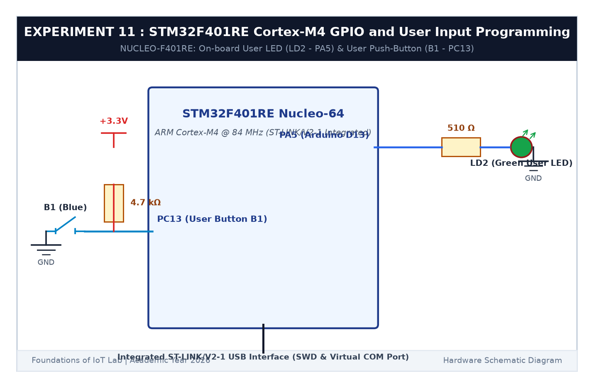

# EXPERIMENT DETAILS

**EXP:** CONTINUOUS ASSESSMENT 11  

**DATE:** 14/10/2026  

**NAME OF EXP:** STM32F401RE Cortex-M4: GPIO and User Input Programming  

**HARDWARE SETUP / PLATFORM:** STMicroelectronics NUCLEO-F401RE Board (ARM Cortex-M4 @ 84 MHz) + Integrated ST-LINK/V2-1 + Keil MDK-ARM + STM32CubeMX  

---

## TASK 11A : On-Board Green LED LD2 Bring-Up (1 Hz)

### 1. Circuit Diagram

This task brings up the on-board user LED on the high-performance STM32 Nucleo-F401RE board.

- **Microcontroller:** STM32F401RET6 (Cortex-M4 with FPU @ 84 MHz)
- **On-board User LED (LD2):** Connected to pin `PA5` (Active HIGH: logic 1 = ON, logic 0 = OFF)

### 2. Core Logic

- Configure pin `PA5` as GPIO Output Push-Pull via STM32CubeMX.
- In `main()`, toggle the pin at 1 Hz using `HAL_GPIO_TogglePin(GPIOA, GPIO_PIN_5); HAL_Delay(500);`.

### 3. Inference

The green LED LD2 on `PA5` blinked steadily at 1 Hz. Note that unlike the Blue Pill's active-low LED on `PC13`, the Nucleo LD2 is active-high.
