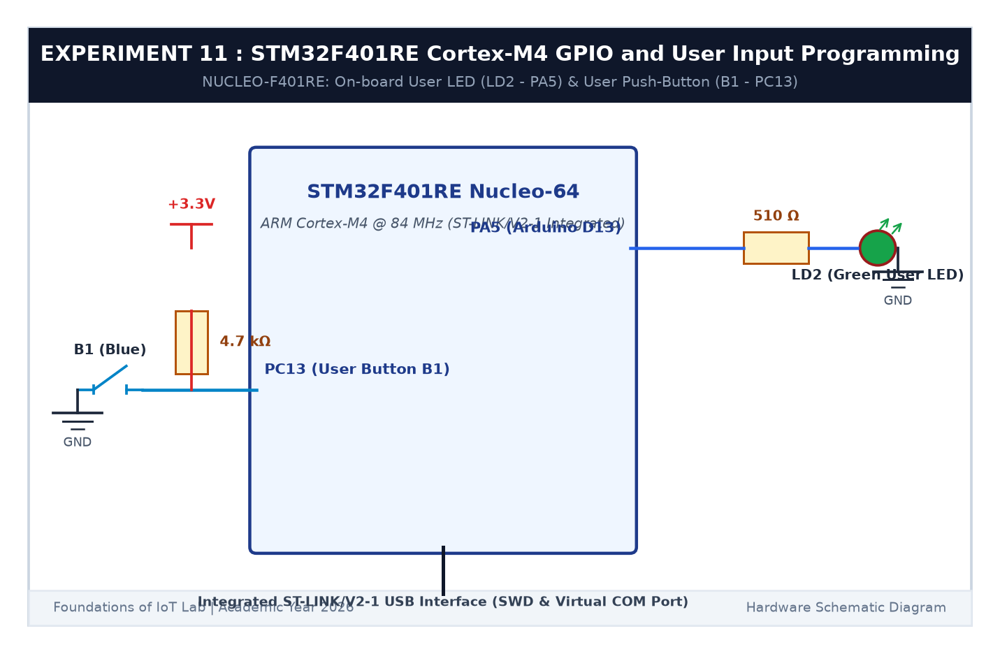

# EXPERIMENT DETAILS

**EXP:** CONTINUOUS ASSESSMENT 11  

**DATE:** 14/10/2026  

**NAME OF EXP:** STM32F401RE Cortex-M4: GPIO and User Input Programming  

**HARDWARE SETUP / PLATFORM:** STMicroelectronics NUCLEO-F401RE Board + Keil MDK-ARM + STM32CubeMX  

---

## TASK 11B : Push Button B1 State Remembrance

### 1. Circuit Diagram

This task reads the on-board blue user button B1 and remembers the LED state across presses.

- **Microcontroller:** STM32F401RE
- **User Button (B1):** Connected to `PC13` with hardware pull-up (Active LOW: logic 0 = Pressed, logic 1 = Released)
- **User LED (LD2):** Connected to `PA5` (Active HIGH)

### 2. Core Logic

1. Poll `HAL_GPIO_ReadPin(GPIOC, GPIO_PIN_13)`.
2. On detecting `GPIO_PIN_RESET` (button pressed), debounce with a 25 ms delay.
3. Toggle LED `PA5` and wait for button release.

### 3. Inference

The system remembered the LED state after the button was released, functioning as a reliable bistable toggle switch.
