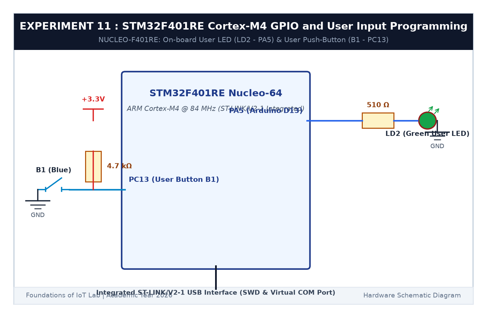

# EXPERIMENT DETAILS

**EXP:** CONTINUOUS ASSESSMENT 11  

**DATE:** 14/10/2026  

**NAME OF EXP:** STM32F401RE Cortex-M4: GPIO and User Input Programming  

**HARDWARE SETUP / PLATFORM:** STMicroelectronics NUCLEO-F401RE Board + Keil MDK-ARM + STM32CubeMX  

---

## TASK 11C : Non-Blocking Short vs Long Press Detection

### 1. Circuit Diagram

This task implements non-blocking duration measurement for user button B1 on the Nucleo board using `HAL_GetTick()`.

- **Microcontroller:** STM32F401RE
- **Peripherals:** User Button B1 on `PC13`, Green LED LD2 on `PA5`

### 2. Event Classification

- **Short Press (< 1000 ms):** Toggles LED on/off.
- **Long Press (>= 1000 ms):** Enters fast 5 Hz blinking mode.
- **Subsequent Short Press:** Cancels blinking and turns LED off.

### 3. Inference

`HAL_GetTick()` provided precise, non-blocking press duration detection while keeping concurrent 5 Hz LED blinking smooth and responsive.
