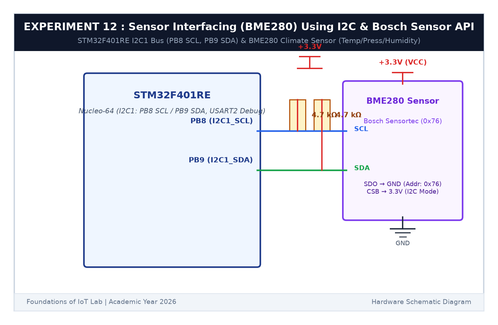

# EXPERIMENT DETAILS

**EXP:** CONTINUOUS ASSESSMENT 12  

**DATE:** 23/10/2026  

**NAME OF EXP:** Sensor Interfacing (BME280) – STM32(Debug) – ESP8266(Wi-Fi) HTTP – Node Analytics / BME280 Sensor Interfacing Using I2C and Bosch Sensor API  

**HARDWARE SETUP / PLATFORM:** STMicroelectronics NUCLEO-F401RE Development Board + Bosch Sensortec BME280 Environmental Sensor Module + Keil MDK-ARM + STM32CubeMX + PuTTY  

---

## TASK 12 : BME280 Sensor Interfacing over I2C & Bosch Sensor API

### 1. Circuit Diagram

The circuit interfaces the digital BME280 sensor to the STM32F401RE microcontroller across the hardware I2C1 bus.

- **Microcontroller:** STM32F401RE (Nucleo-64)
- **Sensor:** Bosch Sensortec BME280 Combined Temperature, Pressure & Humidity Sensor
- **I2C Bus Signals:**
  - `PB8`: `I2C1_SCL` (Serial Clock line with 4.7 kΩ pull-up to +3.3V)
  - `PB9`: `I2C1_SDA` (Serial Data line with 4.7 kΩ pull-up to +3.3V)
- **Device Address Selection:** SDO tied to GND $\implies$ 7-bit I2C Address = `0x76` (`BME280_I2C_ADDR_PRIM`)
- **Supply Voltage:** +3.3V DC and Common Ground



### 2. Core Logic / Bosch API Wrappers

The official Bosch Sensortec BME280 Sensor API requires three user-defined platform abstraction hooks:

1. **`user_i2c_read(reg_addr, *reg_data, len, *intf_ptr)`:** Wraps STM32 HAL `HAL_I2C_Mem_Read()` shifting the 7-bit slave address left by 1 bit (`dev_addr << 1`).
2. **`user_i2c_write(reg_addr, *reg_data, len, *intf_ptr)`:** Wraps STM32 HAL `HAL_I2C_Mem_Write()`.
3. **`user_delay_us(period, *intf_ptr)`:** Converts microseconds to millisecond tick intervals via `HAL_Delay((period / 1000) + 1)`.

```c
dev.intf_ptr = &dev_addr;
dev.intf     = BME280_I2C_INTF;
dev.read     = user_i2c_read;
dev.write    = user_i2c_write;
dev.delay_us = user_delay_us;

rslt = bme280_init(&dev);
bme280_set_sensor_mode(BME280_NORMAL_MODE, &dev);
bme280_get_sensor_data(0x07, &comp_data, &dev);
```

### 3. Inference

The I2C bus communication initialized smoothly at 100 kHz standard clock speed. The driver successfully extracted factory trim calibration parameters from the sensor NVM and calculated calibrated values for temperature, barometric pressure, and relative humidity in real time.
