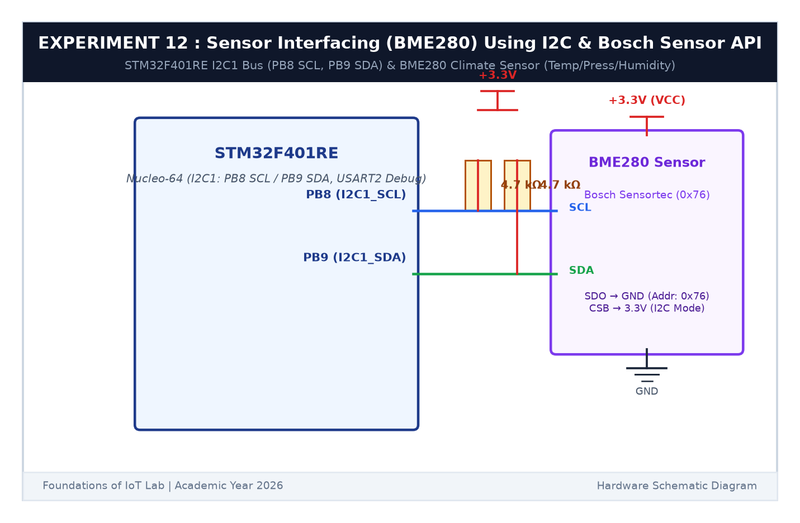

# EXPERIMENT DETAILS

**EXP:** CONTINUOUS ASSESSMENT 12  

**DATE:** 23/10/2026  

**NAME OF EXP:** BME280 Sensor Interfacing Using I2C and Bosch Sensor API  

**HARDWARE SETUP / PLATFORM:** STMicroelectronics NUCLEO-F401RE Development Board + Bosch Sensortec BME280 Sensor Module + Keil MDK-ARM + STM32CubeMX + PuTTY  

---

## TASK 12A : I2C Hardware Bus Bring-Up & Sensor Detection

### 1. Circuit Diagram

This task brings up the I2C1 communication bus on the Nucleo board and verifies the presence of the BME280 sensor.

- **Microcontroller:** STM32F401RE
- **I2C1 Peripheral:** `PB8` (SCL), `PB9` (SDA) with two 4.7kΩ pull-up resistors to +3.3V
- **Sensor Power:** 3.3V and GND
- **Primary I2C Address:** `0x76` (SDO pin grounded)

### 2. Hardware Detection

1. Check device readiness using `HAL_I2C_IsDeviceReady(&hi2c1, 0x76 << 1, 3, 100)`.
2. Read Chip ID register (`0xD0`). The BME280 returns `0x60`, confirming correct sensor identification.

### 3. Inference

The I2C bus initialized at 100 kHz Standard Mode and confirmed chip ID `0x60` at address `0x76`.
