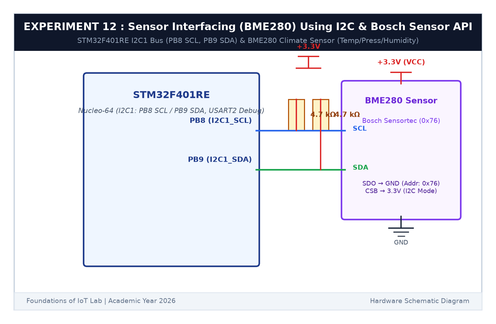

# EXPERIMENT DETAILS

**EXP:** CONTINUOUS ASSESSMENT 12  

**DATE:** 23/10/2026  

**NAME OF EXP:** BME280 Sensor Interfacing Using I2C and Bosch Sensor API  

**HARDWARE SETUP / PLATFORM:** STMicroelectronics NUCLEO-F401RE Development Board + Bosch Sensortec BME280 Sensor Module + Keil MDK-ARM + STM32CubeMX  

---

## TASK 12B : Bosch Sensor API Wrapper & Normal Mode Sampling

### 1. Circuit Diagram

This task integrates the official Bosch Sensortec BME280 driver library into the STM32 HAL environment.

- **Microcontroller:** STM32F401RE
- **Bus:** `I2C1` (`PB8` SCL, `PB9` SDA)

### 2. Bosch Driver Wrapper Functions

- `bme280_i2c_read()`: Maps to `HAL_I2C_Mem_Read()`.
- `bme280_i2c_write()`: Maps to `HAL_I2C_Mem_Write()`.
- `bme280_delay_ms()`: Maps to `HAL_Delay()`.
- Sensor set to **Normal Mode** with oversampling: Temp x2, Pressure x16, Humidity x1, IIR filter 16.

### 3. Inference

The Bosch API loaded factory trim calibration parameters and configured normal-mode continuous measurement cycles.
