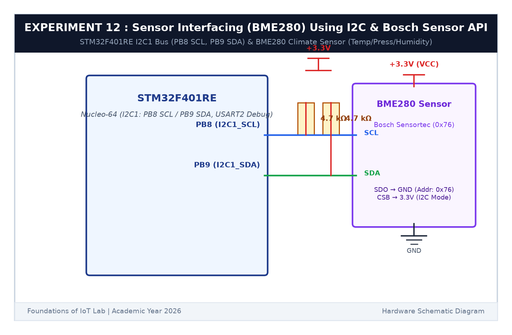

# EXPERIMENT DETAILS

**EXP:** CONTINUOUS ASSESSMENT 12  

**DATE:** 23/10/2026  

**NAME OF EXP:** BME280 Sensor Interfacing Using I2C and Bosch Sensor API  

**HARDWARE SETUP / PLATFORM:** STMicroelectronics NUCLEO-F401RE Development Board + Bosch Sensortec BME280 Sensor Module + PC PuTTY Terminal  

---

## TASK 12C : Multi-Variable Telemetry Output over UART

### 1. Circuit Diagram

This task acquires compensated temperature, humidity, and atmospheric pressure data and streams it over UART2 to the PC terminal.

- **Microcontroller:** STM32F401RE
- **Sensor:** BME280 over I2C1
- **Serial Output:** `USART2` (`PA2`/`PA3`) via ST-LINK Virtual COM Port at 115200 baud



### 2. Output Data Sample

```text
========================================
   BME280 Environmental Sensor System
========================================
[INFO] I2C Device detected at 0x76
[INFO] Chip ID = 0x60 (BME280 verified)
[INFO] Calibration parameters loaded.

[DATA] Temp: 26.42 C | Press: 1013.25 hPa | Hum: 58.30 %
[DATA] Temp: 26.45 C | Press: 1013.22 hPa | Hum: 58.24 %
```

### 3. Inference

The STM32 accurately sampled and formatted all three environmental variables, printing continuous real-time readings to PuTTY.
