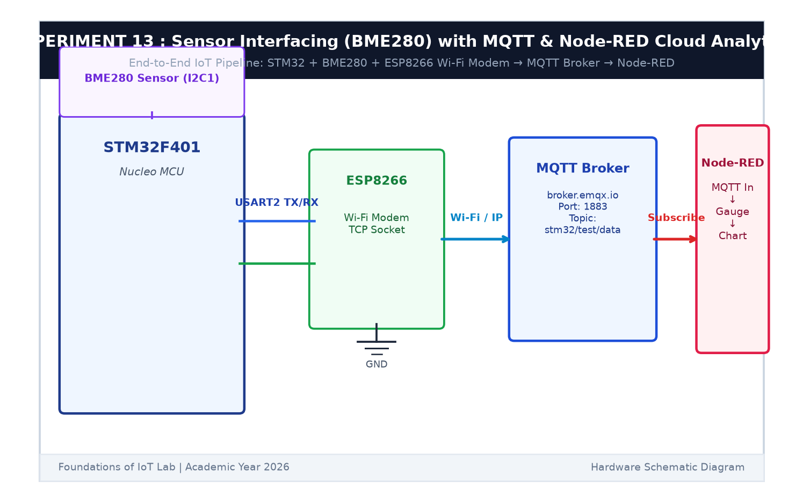

# EXPERIMENT DETAILS

**EXP:** CONTINUOUS ASSESSMENT 13  

**DATE:** 27/10/2026  

**NAME OF EXP:** Sensor Interfacing (BME280) – (MQTT) – Node Analytics / BME280 Sensor Interfacing Using I2C and (MQTT) using Custom Built ESP8266 API  

**HARDWARE SETUP / PLATFORM:** STMicroelectronics NUCLEO-F401RE Development Board + Bosch Sensortec BME280 I2C Sensor + Wemos D1 Mini (ESP8266 Wi-Fi Module) + Cloud MQTT Broker (`broker.emqx.io:1883`) + Node-RED Dashboard  

---

## TASK 13A & 13B : ESP8266 MQTT Client Driver & Telemetry Publishing

### 1. Circuit Diagram

The circuit integrates the STM32F401RE controller, BME280 environmental sensor over I2C1, and the ESP8266 Wi-Fi transceiver over USART2.

- **Microcontroller:** STM32F401RE (Nucleo-64)
- **Sensor:** Bosch Sensortec BME280 connected via `PB8` (SCL) and `PB9` (SDA)
- **Wi-Fi Transceiver:** ESP8266 on `USART2` (`PA2` TX, `PA3` RX)
- **Cloud Broker:** Public EMQX MQTT Broker (`broker.emqx.io` on TCP port `1883`)
- **Telemetry Publishing Topic:** `stm32/test/data` (QoS 0)
- **Command Subscription Topic:** `stm32/control` (QoS 0)



### 2. Custom ESP8266 MQTT Driver Architecture

The custom driver abstraction (`ESPLib.c` / `ESPLib.h`) manages Wi-Fi associations, TCP socket state machines, and MQTT framing via AT commands:

```c
/* 1. Initialize Wi-Fi in Station Mode */
ESP8266_Init(StationMode, huart2);

/* 2. Connect to Local Access Point */
ESP8266_wifiConnect("IoT_Lab_AP", "SNU_IoT_2026");

/* 3. Connect TCP Socket to Cloud MQTT Broker */
ESP8266_portConnect("TCP", "broker.emqx.io", "1883");

/* 4. Configure MQTT Client Identity */
MQTT_InitTypeDef_t mqttSetting;
mqttSetting.keepAlive = 500;
mqttSetting.connectFlag = CleanSession;
mqttSetting.clientID = "SNU_STM32_Node080";
MQTT_connectBroker(&mqttSetting);

/* 5. Publish Telemetry & Subscribe to Commands */
MQTT_publishTopic("stm32/test/data", json_payload, QoS0);
MQTT_subscribeTopic("stm32/control", 0);
```

---

## TASK 13C & 13D : Node-RED Cloud Analytics Dashboard

### 1. Node-RED Architecture & Data Pipeline

The Node-RED dashboard acts as the centralized cloud analytics interface:
1. **`mqtt in` node:** Subscribes to `stm32/test/data` from `broker.emqx.io`.
2. **`json` parser:** Decodes the incoming JSON payload (`{"temp": 25.40, "hum": 58.20}`).
3. **`ui_gauge` node:** Visualizes instantaneous ambient temperature.
4. **`ui_chart` node:** Plots historical relative humidity trends over time.
5. **`ui_switch` node:** Sends actuation commands to `stm32/control` to remotely toggle the onboard LED on the STM32 Nucleo board.

### 2. Dashboard Flow Configuration (`node_red_mqtt_dashboard.json`)

The complete ready-to-import Node-RED JSON flow is provided in `node_red_mqtt_dashboard.json`.

### 3. Inference

The end-to-end IoT pipeline established continuous, bi-directional telemetry and actuation. The STM32 acquired real-time environmental data from the BME280 sensor via I2C, formatted it into structured JSON packets, and transmitted it through the ESP8266 modem to the cloud EMQX broker. The Node-RED dashboard displayed live gauges and charts while providing remote LED override capabilities.
