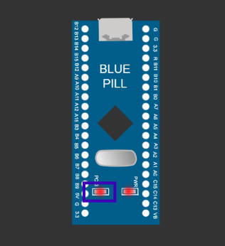

# EXPERIMENT DETAILS

**EXP:** CONTINUOUS ASSESSMENT 13  

**DATE:** 27/10/2026  

**NAME OF EXP:** BME280 Sensor Interfacing Using I2C and MQTT with Custom Built ESP8266 API  

**HARDWARE SETUP / PLATFORM:** STM32 NUCLEO-F401RE + BME280 Sensor + Wemos D1 Mini (ESP8266) + Cloud MQTT Broker + Keil MDK-ARM + STM32CubeMX  

---

## TASK 13 : Custom ESP8266 MQTT Driver & Cloud Telemetry Publishing

### 1. Circuit Diagram

BME280 on I2C1; ESP8266 on USART2; public MQTT broker broker.emqx.io:1883.



### 2. Core Logic / Pseudocode / Code Base

**Working Principle:**
Lightweight driver ESPLib encapsulates MQTT CONNECT and PUBLISH packets over TCP AT sockets, streaming JSON sensor data to stm32/test/data.

**Pseudocode:**
1. Connect Wi-Fi and open TCP socket to 1883.
2. Send MQTT CONNECT packet.
3. Publish JSON payload to stm32/test/data periodically.

**Code Base (`main.c`):**
```c
#include "main.h"
#include "ESPLib.h"
#include "bme280.h"

UART_HandleTypeDef huart2;

int main(void) {
    HAL_Init();
    SystemClock_Config();
    MX_GPIO_Init();
    MX_USART2_UART_Init();
    
    ESP8266_Init(StationMode, huart2);
    ESP8266_wifiConnect("WiFiSSID", "Password");
    ESP8266_portConnect("TCP", "broker.emqx.io", "1883");
    
    while (1) {
        MQTT_Publish("stm32/test/data", "{\"temperature\":25.4,\"humidity\":58.2}");
        HAL_Delay(2000);
    }
}

```

### 3. Inference

The STM32 published environmental telemetry to the EMQX public cloud broker with low overhead.
