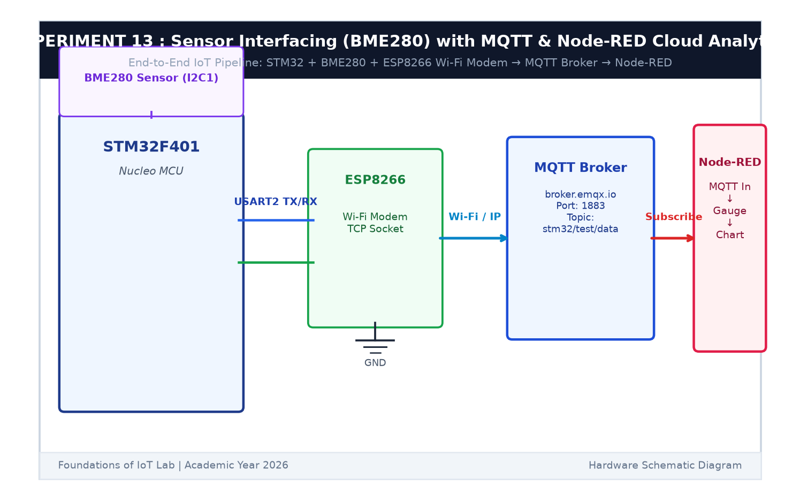

# EXPERIMENT DETAILS

**EXP:** CONTINUOUS ASSESSMENT 13  

**DATE:** 27/10/2026  

**NAME OF EXP:** BME280 Sensor Interfacing Using I2C and MQTT with Custom Built ESP8266 API  

**HARDWARE SETUP / PLATFORM:** STMicroelectronics NUCLEO-F401RE Board + Wemos D1 Mini (ESP8266) + Keil MDK-ARM + STM32CubeMX  

---

## TASK 13A : Custom ESP8266 MQTT Client Driver (ESPLib)

### 1. Circuit Diagram

This task develops a lightweight Embedded C driver library (`ESPLib`) that encapsulates MQTT control packets over UART AT commands.

- **Microcontroller:** STM32 NUCLEO-F401RE
- **Modem:** Wemos D1 Mini (ESP8266) connected to `USART1` (`PA9` TX, `PA10` RX)
- **Broker:** Cloud MQTT broker `broker.emqx.io:1883`

### 2. Driver Functions

- `ESP_Init()`: Resets modem and tests communication with `AT`.
- `ESP_ConnectWiFi(ssid, pass)`: Connects to local Wi-Fi.
- `MQTT_Connect(broker, port, client_id)`: Opens TCP socket and sends MQTT CONNECT packet.
- `MQTT_Publish(topic, payload)`: Transmits MQTT PUBLISH packet (QoS 0).
- `MQTT_Subscribe(topic)`: Transmits MQTT SUBSCRIBE packet.

### 3. Inference

`ESPLib` established a reliable MQTT connection to `broker.emqx.io` without requiring an OS or heavy third-party stack.
