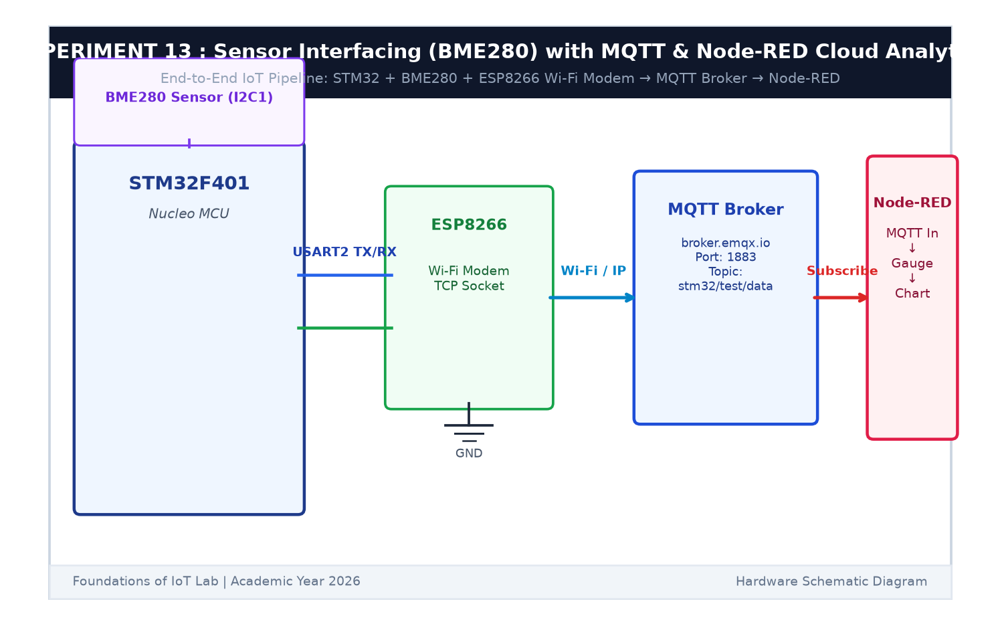

# EXPERIMENT DETAILS

**EXP:** CONTINUOUS ASSESSMENT 13  

**DATE:** 27/10/2026  

**NAME OF EXP:** BME280 Sensor Interfacing Using I2C and MQTT with Custom Built ESP8266 API  

**HARDWARE SETUP / PLATFORM:** STMicroelectronics NUCLEO-F401RE Board + Bosch BME280 Sensor + Wemos D1 Mini + Keil MDK-ARM + STM32CubeMX  

---

## TASK 13B : Cloud Telemetry Publishing & Remote Actuation

### 1. Circuit Diagram

This task reads BME280 sensor data over I2C and publishes JSON telemetry to the MQTT broker, while subscribing to remote actuator commands.

- **Microcontroller:** STM32 NUCLEO-F401RE
- **Sensor:** BME280 on `I2C1`
- **Modem:** ESP8266 on `USART1`
- **Actuator:** On-board LED LD2 on `PA5`

### 2. Topics & Payloads

- **Telemetry Topic (Publish):** `stm32/test/data`  
  Format: `{"temperature": 26.4, "humidity": 58.2, "pressure": 1013.2}`
- **Actuator Topic (Subscribe):** `stm32/control`  
  Payload `"1"` turns LED ON; payload `"0"` turns LED OFF.

### 3. Inference

The system successfully published periodic telemetry to the cloud broker and toggled the physical LED in response to incoming MQTT control messages.
