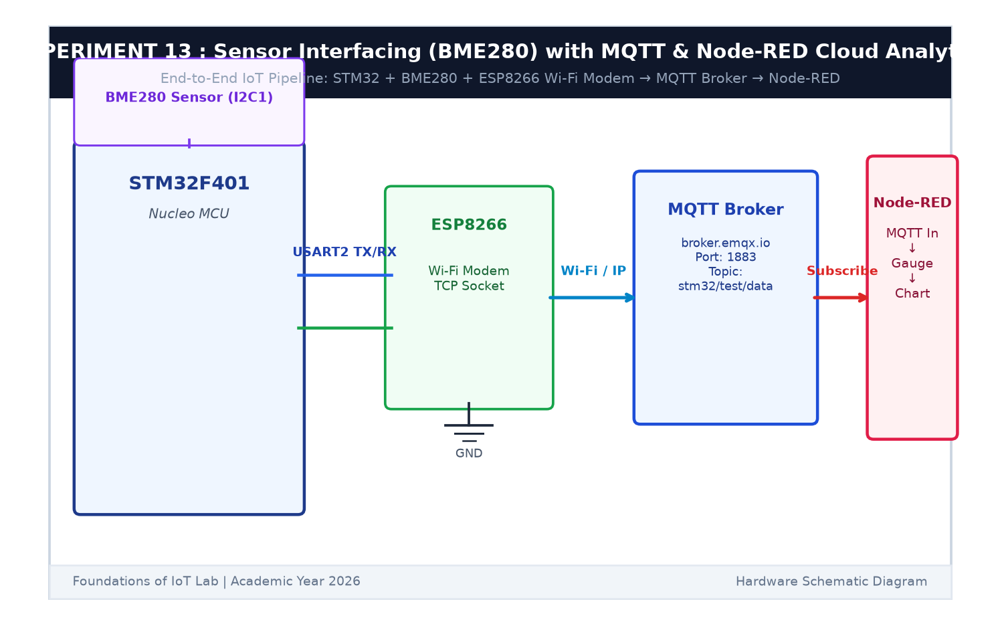

# EXPERIMENT DETAILS

**EXP:** CONTINUOUS ASSESSMENT 13  

**DATE:** 27/10/2026  

**NAME OF EXP:** BME280 Sensor Interfacing Using I2C and MQTT with Custom Built ESP8266 API  

**HARDWARE SETUP / PLATFORM:** STMicroelectronics NUCLEO-F401RE Board + BME280 + ESP8266 + Node-RED Dashboard  

---

## TASK 13C : Node-RED IoT Cloud Analytics Dashboard

### 1. Circuit Diagram

This task builds a real-time web dashboard using Node-RED to visualize telemetry data and provide a UI switch for remote actuator control.

- **Broker:** `broker.emqx.io:1883`
- **Dashboard:** Node-RED UI with Gauges, Trends Chart, and Toggle Switch

### 2. Dashboard UI Elements

The file `node_red_mqtt_dashboard.json` configures:
- **Radial Temperature Gauge:** Displays live ambient temperature in °C.
- **Linear Humidity Gauge:** Displays relative humidity percentage.
- **Historical Trend Chart:** Plots real-time temperature and humidity curves.
- **UI Switch:** Publishes `"1"` or `"0"` to `stm32/control` to toggle the Nucleo LED remotely.

### 3. Inference

The Node-RED dashboard provided an intuitive graphical user interface that displayed live sensor data and remotely actuated the microcontroller LED across the internet.
