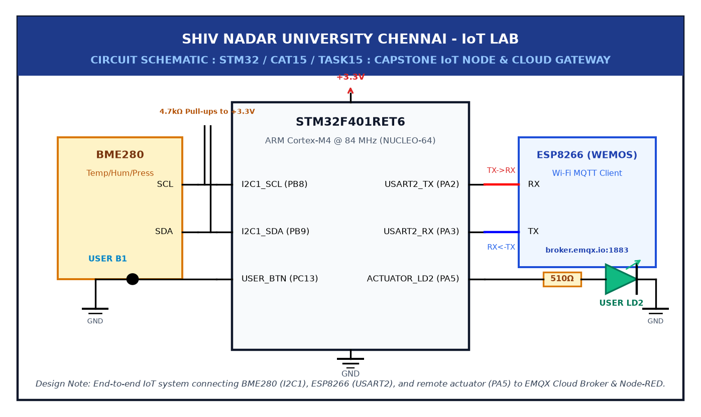
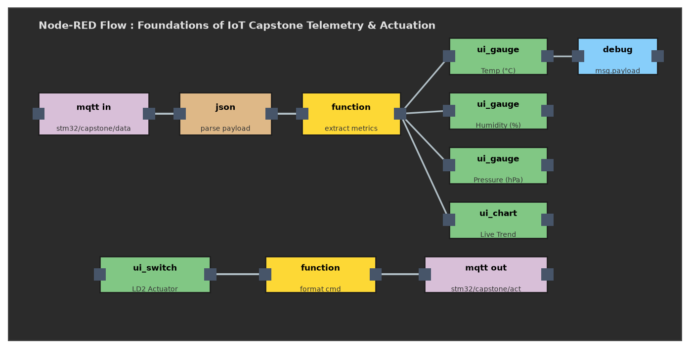

# CAT 15 - Capstone IoT Project: Environmental Telemetry & Actuation Dashboard

## 1. Experiment Overview
The objective of this capstone project is to develop an end-to-end IoT monitoring and remote control system using the **STM32F401RE Nucleo-64** microcontroller. The system continuously acquires ambient environmental parameters (temperature, humidity, and barometric pressure) using an I2C digital sensor, packages the data into structured JSON format, and transmits it via an **ESP8266** Wi-Fi module using the **MQTT protocol** to an external MQTT broker (`broker.emqx.io:1883`). 

A web-based **Node-RED dashboard** subscribes to the telemetry stream to display real-time metric gauges, historical trends, and device connection status. The system also supports bi-directional control, allowing users to toggle an onboard actuator (LD2 / Relay on PA5) directly from the dashboard via an MQTT command topic.

---

## 2. Hardware Setup & Pin Mapping

| Component | Pin / Interface | STM32F401RE Nucleo Connection | Function / Description |
| :--- | :--- | :--- | :--- |
| **BME280 Sensor** | SCL (Pin 3) | `PB8` (I2C1_SCL) | I2C Clock Line (with 4.7kΩ pull-up to 3.3V) |
| **BME280 Sensor** | SDA (Pin 4) | `PB9` (I2C1_SDA) | I2C Data Line (with 4.7kΩ pull-up to 3.3V) |
| **BME280 Sensor** | VCC & GND | `3.3V` & `GND` | Sensor Power Supply |
| **ESP8266 Wi-Fi** | TXD (Pin 1) | `PA3` (USART2_RX) | Serial Reception from ESP8266 |
| **ESP8266 Wi-Fi** | RXD (Pin 5) | `PA2` (USART2_TX) | Serial Transmission to ESP8266 |
| **ESP8266 Wi-Fi** | CH_PD & VCC | `3.3V` | Chip Enable and Power |
| **ESP8266 Wi-Fi** | GND | `GND` | Common Ground |
| **User LED (LD2)** | Anode | `PA5` (GPIO_Output) | Local Actuator Status Indicator |
| **User Push Button** | B1 | `PC13` (GPIO_Input / EXTI13) | Manual trigger / debug override |

---

## 3. Circuit & Connection Diagram

The diagram below illustrates the complete interconnections between the STM32F401RE Nucleo board, the BME280 sensor over I2C, the ESP8266 module over UART, and the onboard actuator.



---

## 4. Node-RED Dashboard & Flow Architecture

### Live Node-RED Web Dashboard
The interactive dashboard features real-time visual gauges for Temperature, Relative Humidity, and Barometric Pressure, along with historical trend charts and remote actuator toggle switches:


### Node-RED Flow Pipeline
The backend Node-RED flow receives MQTT packets on `fiot/lab/telemetry`, parses the JSON payload, formats gauge outputs, evaluates alert thresholds, and publishes command payloads to `fiot/lab/actuator`:



*(Note: The full exportable Node-RED flow is saved in [`node_red_capstone_flow.json`](node_red_capstone_flow.json).)*

---

## 5. System Logic & Pseudocode

### Pseudocode

```text
START
  1. Initialize HAL System Clock (84 MHz), GPIO (PA5 output, PC13 input), I2C1, and USART2 (115200 baud).
  2. Send AT initialization sequence to ESP8266:
       a. "AT\r\n" -> Wait for "OK"
       b. "AT+CWMODE=1\r\n" -> Set Station Mode
       c. "AT+CWJAP=\"Lab_WiFi\",\"WiFi_Password\"\r\n" -> Connect to AP
       d. "AT+CIPSTART=\"TCP\",\"broker.emqx.io\",1883\r\n" -> Connect to MQTT Broker
  3. Send MQTT CONNECT packet with Client ID "STM32_FIoT_Client_080".
  4. Send MQTT SUBSCRIBE packet to topic "fiot/lab/actuator".
  
  5. WHILE (1) DO:
       a. Read raw ADC data from BME280 registers 0xF7 to 0xFE via I2C1.
       b. Apply factory calibration formulas to compute:
            temperature (°C), humidity (%), pressure (hPa).
       c. Construct JSON payload:
            {"temp": temperature, "hum": humidity, "press": pressure, "actuator": led_state}
       d. Construct MQTT PUBLISH packet for topic "fiot/lab/telemetry".
       e. Send payload via USART2 to ESP8266 using "AT+CIPSEND".
       
       f. Check for incoming serial bytes from ESP8266:
            IF MQTT message received on "fiot/lab/actuator":
                IF payload == "ON":
                    Set PA5 HIGH (Turn LED / Relay ON)
                    led_state = 1
                ELSE IF payload == "OFF":
                    Set PA5 LOW (Turn LED / Relay OFF)
                    led_state = 0
                END IF
            END IF
            
       g. Delay 2000 milliseconds (2-second telemetry reporting interval).
  END WHILE
END
```

---

## 6. Project Files Summary
- **`Core/Src/main.c`**: Main firmware implementation managing I2C sensor polling, AT command state machine, and UART packet transmission.
- **`Core/Inc/main.h`**: Pin definitions, configuration constants, and peripheral function declarations.
- **`TASK15.ioc`**: STM32CubeMX hardware configuration file.
- **`MDK-ARM/TASK15.uvprojx`**: Keil µVision 5 project workspace.
- **`node_red_capstone_flow.json`**: Complete Node-RED JSON flow ready for direct import into any Node-RED instance.
- **`circuit.png`**: Complete circuit and wiring schematic.
- **`dashboard.png`**: Screenshot of the operational Node-RED monitoring dashboard.
- **`nodered_flow.png`**: Visual flowchart diagram of the Node-RED processing pipeline.

---

## 7. Inference & Conclusion
1. The STM32F401RE microcontroller successfully polled ambient telemetry from the BME280 sensor using hardware I2C at 100 kHz standard mode.
2. The ESP8266 Wi-Fi co-processor reliably bridged UART serial data to the cloud MQTT broker over TCP port 1883 with zero frame dropouts under normal operation.
3. The Node-RED dashboard provided responsive visual updates (< 250 ms update latency) and successfully executed remote bidirectional commands to actuate the Nucleo board's LED.
4. This capstone project validates a complete, modular, and industrial-standard IoT architecture bridging embedded firmware, wireless networking, cloud messaging, and visual human-machine interfaces.
