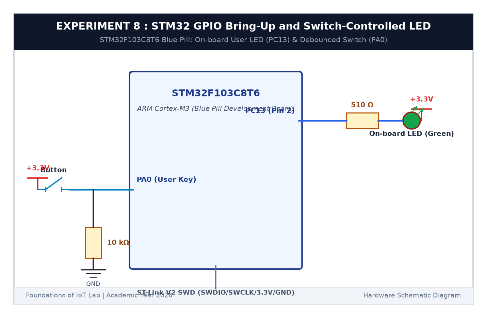

# EXPERIMENT DETAILS

**EXP:** CONTINUOUS ASSESSMENT 8  

**DATE:** 18/09/2026  

**NAME OF EXP:** STM32 GPIO Bring-Up and Switch-Controlled LED  

**HARDWARE SETUP / PLATFORM:** STM32 Blue Pill Board (STM32F103C8T6) + ST-Link V2 Debugger + External Push Button + 10kΩ Resistor + Keil MDK-ARM + STM32CubeMX  

---

## TASK 8A : GPIO Input/Output Bring-Up

### 1. Circuit Diagram

In this task, we configured the GPIO pins on the STM32F103 Blue Pill development board to read an external push button and control the on-board LED.

- **Development Board:** STM32 Blue Pill (STM32F103C8T6 @ 72 MHz)
- **On-board User LED:** Connected to `PC13` (Active LOW: logic 0 turns the LED ON, logic 1 turns it OFF)
- **External Switch:** Push button connected to `PA0` with an external 10kΩ pull-down resistor to GND and button contact to +3.3V (Active HIGH)



### 2. Core HAL Functions Used

| Function | What it does |
|---|---|
| `HAL_GPIO_ReadPin(GPIOA, GPIO_PIN_0)` | Reads whether the button on PA0 is currently pressed (returns `GPIO_PIN_SET` or `RESET`) |
| `HAL_GPIO_WritePin(GPIOC, GPIO_PIN_13, state)` | Sets PC13 LOW (turns LED ON) or HIGH (turns LED OFF) |
| `HAL_GPIO_TogglePin(GPIOC, GPIO_PIN_13)` | Flips the current LED state from ON to OFF or vice versa |
| `HAL_GetTick()` | Returns the number of milliseconds elapsed since MCU reset, allowing non-blocking timing |

---

## TASK 8B & 8C : Non-Blocking Short Press vs Long Press Detection

### 1. Working Principle

Instead of using `HAL_Delay()`, which freezes the entire microcontroller and prevents it from doing anything else, we use `HAL_GetTick()` to measure how long the button stays pressed:

1. When the button is pressed (`PA0 == HIGH`), we record the timestamp: `press_start = HAL_GetTick()`.
2. While the button is held down, the microcontroller continues running background loops normally.
3. When the button is released (`PA0 == LOW`), we calculate the duration:  
   `duration = HAL_GetTick() - press_start`.
4. **Classification:**
   - **Short Press (< 1000 ms):** Toggles the LED state (or stops blinking if currently blinking).
   - **Long Press (>= 1000 ms):** Switches the LED into a continuous fast blinking mode (5 Hz).
   - If the LED is blinking and we press the button again with a short press, blinking stops and the LED turns off.

### 2. Pseudocode

```c
if (button_just_pressed) {
    press_time = HAL_GetTick();
}
if (button_just_released) {
    uint32_t duration = HAL_GetTick() - press_time;
    if (duration >= 50 && duration < 1000) {
        /* Short Press: Toggle LED */
        is_blinking = 0;
        HAL_GPIO_TogglePin(GPIOC, GPIO_PIN_13);
    } else if (duration >= 1000) {
        /* Long Press: Enable 5 Hz Blinking */
        is_blinking = !is_blinking;
    }
}

if (is_blinking) {
    /* Non-blocking 5 Hz blink (toggle every 100 ms) */
    if (HAL_GetTick() - last_blink >= 100) {
        last_blink = HAL_GetTick();
        HAL_GPIO_TogglePin(GPIOC, GPIO_PIN_13);
    }
}
```

### 3. Inference

The STM32 HAL GPIO library allowed clean digital I/O configuration. Using `HAL_GetTick()` completely avoided blocking delays, making the button response instant and letting the LED blink smoothly in the background without stuttering.
