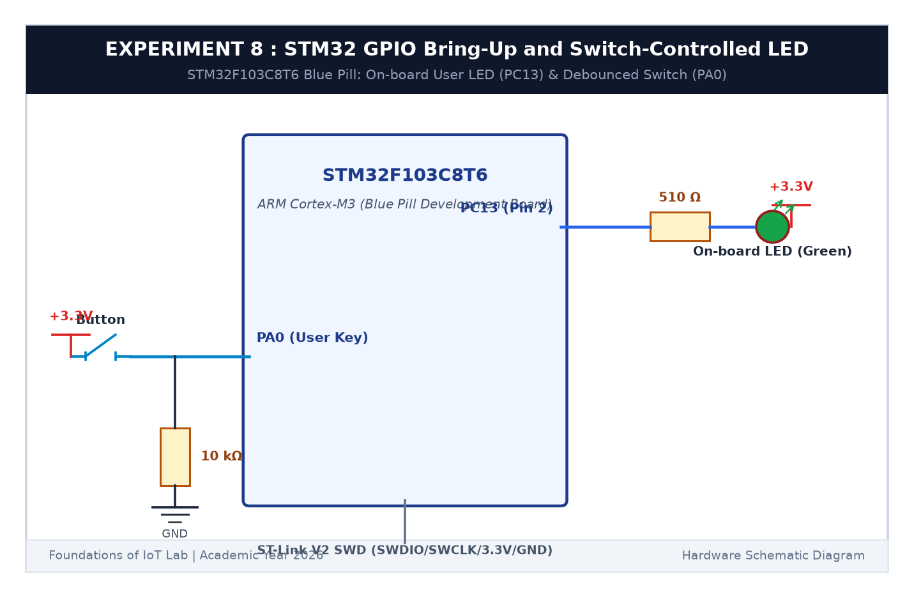

# EXPERIMENT DETAILS

**EXP:** CONTINUOUS ASSESSMENT 8  

**DATE:** 18/09/2026  

**NAME OF EXP:** STM32 GPIO Bring-Up and Switch-Controlled LED  

**HARDWARE SETUP / PLATFORM:** STM32 Blue Pill Board (STM32F103C8T6 @ 72 MHz) + ST-Link V2 Debugger + External Push Button + Keil MDK-ARM + STM32CubeMX  

---

## TASK 8A : GPIO Input/Output Bring-Up

### 1. Circuit Diagram

This task configures GPIO input and output pins on the STM32F103 Blue Pill board using the STM32 HAL library.

- **Microcontroller:** STM32F103C8T6 (ARM Cortex-M3 @ 72 MHz)
- **On-board LED:** Connected to `PC13` (Active LOW: logic 0 = ON, logic 1 = OFF)
- **External Switch:** Tactile button connected to `PA0` with 10kΩ pull-down resistor to GND and button contact to +3.3V (Active HIGH)

### 2. Core HAL Functions

- `HAL_GPIO_ReadPin(GPIOA, GPIO_PIN_0)`: Reads the digital logic state of the button on PA0.
- `HAL_GPIO_WritePin(GPIOC, GPIO_PIN_13, GPIO_PIN_RESET)`: Turns the LED ON.
- `HAL_GPIO_WritePin(GPIOC, GPIO_PIN_13, GPIO_PIN_SET)`: Turns the LED OFF.

### 3. Inference

The microcontroller mirrored the external switch state to the on-board LED reliably.
