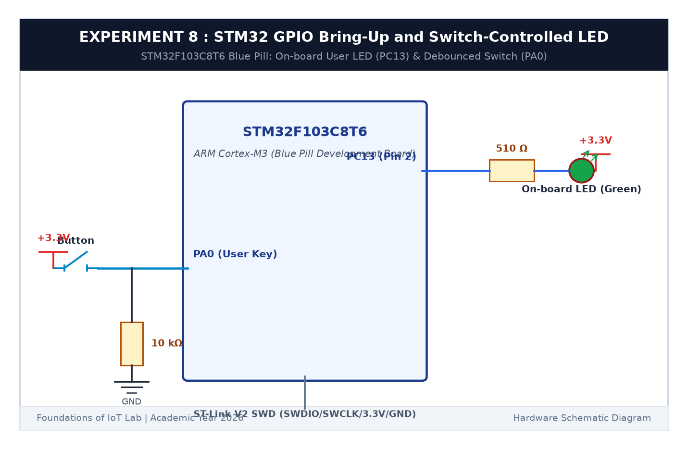

# EXPERIMENT DETAILS

**EXP:** CONTINUOUS ASSESSMENT 8  

**DATE:** 18/09/2026  

**NAME OF EXP:** STM32 GPIO Bring-Up and Switch-Controlled LED  

**HARDWARE SETUP / PLATFORM:** STM32 Blue Pill Board (STM32F103C8T6) + Push Button + Keil MDK-ARM + STM32CubeMX  

---

## TASK 8B : Debounced Switch State Toggle

### 1. Circuit Diagram

This task implements debounced push-button toggling where each button press toggles the on-board LED state.

- **Microcontroller:** STM32F103C8T6
- **Pins:** Button on `PA0` (pull-down), LED on `PC13` (Active LOW)

### 2. Core Logic

1. Detect rising edge transition on pin `PA0`.
2. Confirm state after a 25 ms debounce delay using `HAL_GetTick()`.
3. Toggle `PC13` using `HAL_GPIO_TogglePin(GPIOC, GPIO_PIN_13)`.
4. Wait for button release to avoid repeated toggles.

### 3. Inference

Each distinct press toggled the LED state cleanly without bounce glitches.
