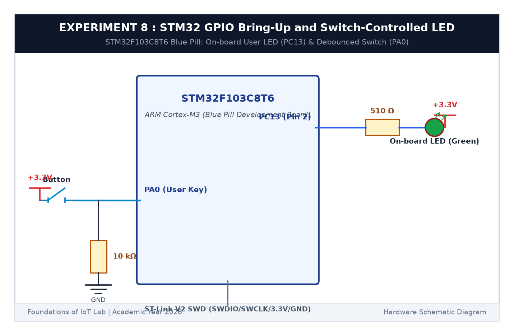

# EXPERIMENT DETAILS

**EXP:** CONTINUOUS ASSESSMENT 8  

**DATE:** 18/09/2026  

**NAME OF EXP:** STM32 GPIO Bring-Up and Switch-Controlled LED  

**HARDWARE SETUP / PLATFORM:** STM32 Blue Pill Board (STM32F103C8T6) + Push Button + Keil MDK-ARM + STM32CubeMX  

---

## TASK 8C : Non-Blocking Short Press vs Long Press Event Classifier

### 1. Circuit Diagram

This task classifies user button presses into short presses (< 1000 ms) and long presses (>= 1000 ms) without using blocking delays.

- **Microcontroller:** STM32F103C8T6
- **Pins:** Button on `PA0`, LED on `PC13`

### 2. Non-Blocking Event Classifier

- **Short Press (< 1000 ms):** Toggles the LED on/off, or cancels active blinking.
- **Long Press (>= 1000 ms):** Switches LED into a fast 5 Hz continuous blinking mode.
- Duration is calculated asynchronously as `HAL_GetTick() - press_start` upon button release.

### 3. Inference

Using `HAL_GetTick()` enabled real-time button duration classification while keeping background 5 Hz LED blinking smooth and unhindered.
