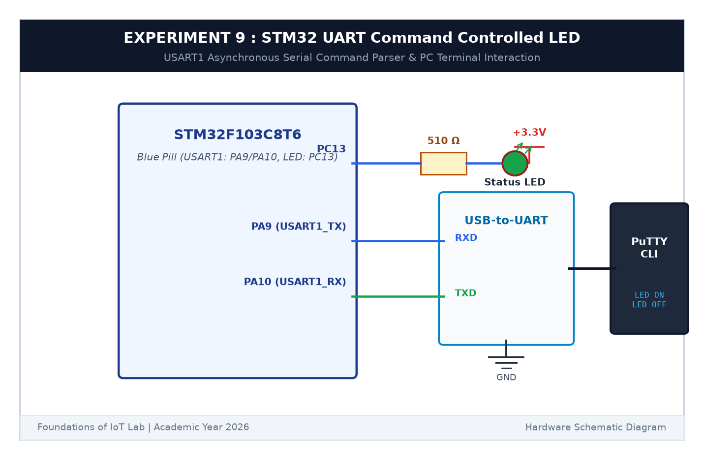

# EXPERIMENT DETAILS

**EXP:** CONTINUOUS ASSESSMENT 9  

**DATE:** 28/09/2026  

**NAME OF EXP:** STM32 UART Command Controlled LED  

**HARDWARE SETUP / PLATFORM:** STM32 Blue Pill Board (STM32F103C8T6) + CP2102 / CH340 USB-to-UART Serial Module + PC running PuTTY Serial Terminal + Keil MDK-ARM + STM32CubeMX  

---

## TASK 9A : UART Character Echo & Line Ending Handling

### 1. Circuit Diagram

We connected the STM32 Blue Pill's hardware USART1 serial port to a PC through a USB-to-TTL serial converter.

- **Microcontroller:** STM32F103C8T6
- **USART1 TX Pin:** `PA9` connected to USB-TTL `RXD`
- **USART1 RX Pin:** `PA10` connected to USB-TTL `TXD`
- **Ground:** Common ground (GND) connected between Blue Pill and USB-TTL
- **On-board LED:** `PC13` (Active LOW)
- **Serial Terminal Parameters:** 115200 Baud, 8 Data Bits, 1 Stop Bit, No Parity (115200-8-N-1)



### 2. Line Termination Analysis (CR vs LF)

Different operating systems and terminal emulators use different line ending characters when Enter is pressed:
- **Carriage Return (`\r`, `0x0D`):** Moves cursor back to the start of the line.
- **Line Feed (`\n`, `0x0A`):** Moves cursor down to the next line.
- **Handling in Code:** We check for either `\r` or `\n` as the command end marker. Whenever either character is detected, our parser terminates the string with a null character (`\0`) and begins processing the command.

---

## TASK 9B : Serial Command Parser

### 1. Supported Commands

The user types commands in the PuTTY terminal. When Enter is pressed, the STM32 parses the string and responds:

| Command Sent | Action Taken | Microcontroller Reply |
|---|---|---|
| `LED ON` | Turns the on-board LED ON (`PC13 = LOW`) | `[STM32] LED is turned ON\r\n` |
| `LED OFF` | Turns the on-board LED OFF (`PC13 = HIGH`) | `[STM32] LED is turned OFF\r\n` |
| `LED TOGGLE`| Inverts the LED's current state | `[STM32] LED toggled\r\n` |
| Any other text | Does not change LED | `[ERROR] Unknown command. Available: LED ON, LED OFF, LED TOGGLE\r\n` |

### 2. Pseudocode

```c
char rx_buf[64];
uint8_t rx_idx = 0;

void process_serial() {
    uint8_t ch;
    if (HAL_UART_Receive(&huart1, &ch, 1, 10) == HAL_OK) {
        HAL_UART_Transmit(&huart1, &ch, 1, 10); /* Echo character to terminal */
        
        if (ch == '\r' || ch == '\n') {
            if (rx_idx > 0) {
                rx_buf[rx_idx] = '\0'; /* Terminate string */
                if (strcmp(rx_buf, "LED ON") == 0) {
                    HAL_GPIO_WritePin(GPIOC, GPIO_PIN_13, GPIO_PIN_RESET);
                    send_string("\r\n[STM32] LED is turned ON\r\n");
                } else if (strcmp(rx_buf, "LED OFF") == 0) {
                    HAL_GPIO_WritePin(GPIOC, GPIO_PIN_13, GPIO_PIN_SET);
                    send_string("\r\n[STM32] LED is turned OFF\r\n");
                } else if (strcmp(rx_buf, "LED TOGGLE") == 0) {
                    HAL_GPIO_TogglePin(GPIOC, GPIO_PIN_13);
                    send_string("\r\n[STM32] LED toggled\r\n");
                } else {
                    send_string("\r\n[ERROR] Unknown command\r\n");
                }
                rx_idx = 0;
            }
        } else {
            if (rx_idx < sizeof(rx_buf) - 1) {
                rx_buf[rx_idx++] = ch;
            }
        }
    }
}
```

### 3. Inference

The Blue Pill established fast and stable serial communication with the host PC at 115200 baud. Characters echoed cleanly as typed, and the string comparison parser executed every command correctly, giving instant feedback to the terminal.
