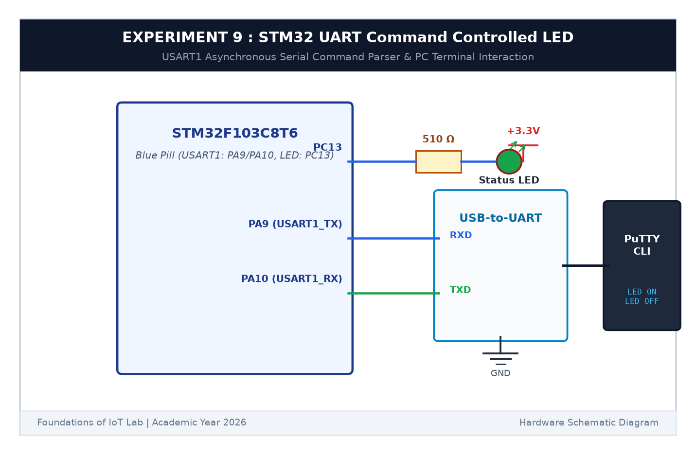

# EXPERIMENT DETAILS

**EXP:** CONTINUOUS ASSESSMENT 9  

**DATE:** 28/09/2026  

**NAME OF EXP:** STM32 UART Command Controlled LED  

**HARDWARE SETUP / PLATFORM:** STM32 Blue Pill Board (STM32F103C8T6) + USB-to-TTL Serial Converter + PC with PuTTY Serial Terminal + Keil MDK-ARM + STM32CubeMX  

---

## TASK 9A : UART Character Echo & Line Termination Analysis

### 1. Circuit Diagram

This task connects the hardware USART1 of the STM32 to a host PC and analyzes serial line ending formats.

- **Microcontroller:** STM32F103C8T6
- **USART1 Pins:** `PA9` (TX) connected to USB-TTL RXD; `PA10` (RX) connected to USB-TTL TXD
- **Serial Config:** 115200 Baud, 8 Data Bits, 1 Stop Bit, No Parity (115200-8-N-1)

### 2. Line Termination (CR vs LF)

- **Carriage Return (`\r`, 0x0D):** Standard in old Mac and Windows newline sequence (`\r\n`).
- **Line Feed (`\n`, 0x0A):** Standard Unix/Linux newline.
- Our driver checks for both `\r` and `\n` to support all terminal emulators reliably.

### 3. Inference

Characters entered in the PuTTY terminal echoed back immediately and line termination was handled seamlessly.
