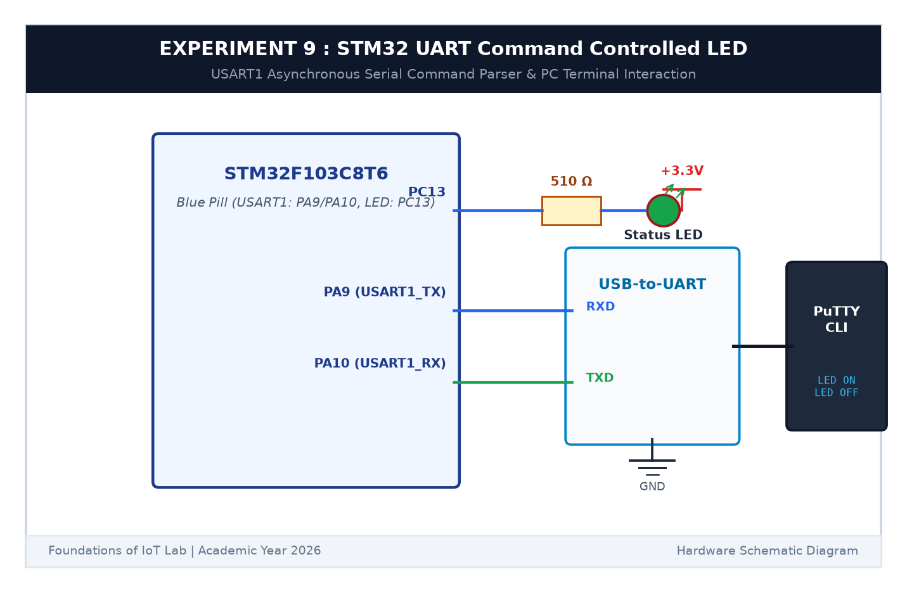

# EXPERIMENT DETAILS

**EXP:** CONTINUOUS ASSESSMENT 9  

**DATE:** 28/09/2026  

**NAME OF EXP:** STM32 UART Command Controlled LED  

**HARDWARE SETUP / PLATFORM:** STM32 Blue Pill Board (STM32F103C8T6) + USB-to-TTL Serial Module + PC Terminal + Keil MDK-ARM + STM32CubeMX  

---

## TASK 9B : Serial Text Command Parser (LED ON/OFF/TOGGLE)

### 1. Circuit Diagram

This task implements a text command parser that controls the on-board LED based on incoming UART strings.

- **Microcontroller:** STM32F103C8T6
- **USART1:** `PA9` (TX), `PA10` (RX)
- **Actuator:** On-board LED on `PC13` (Active LOW)

### 2. Supported Commands

- `LED ON`: Sets `PC13 = LOW` (LED ON), replies `[STM32] LED is turned ON
`.
- `LED OFF`: Sets `PC13 = HIGH` (LED OFF), replies `[STM32] LED is turned OFF
`.
- `LED TOGGLE`: Toggles `PC13`, replies `[STM32] LED toggled
`.
- Any invalid text replies: `[ERROR] Unknown command. Available: LED ON, LED OFF, LED TOGGLE
`.

### 3. Inference

The serial string parser processed all text commands accurately, turning the LED on/off and returning immediate status replies.
